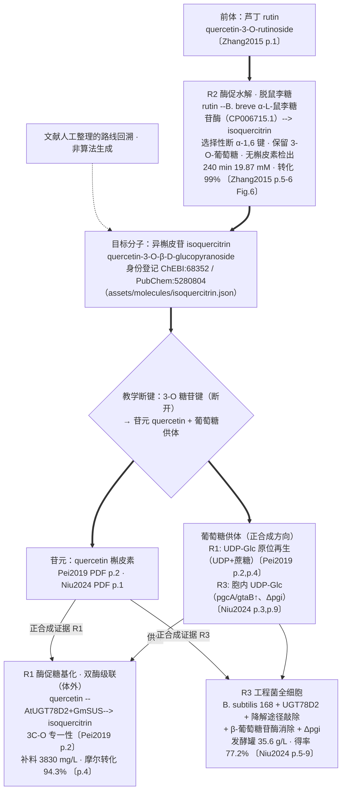

# 虚拟探究实验：产品结构与交互合同

现行设计：TASK-018，2026-10-21，依据所有者直接重构指令；TASK-020按当日实际转交的LYW v5矩阵校正24项主线布局。本文维护产品设计，不替代案例准入、教学量规或实时状态。此前TASK-012工作台及TASK-017学习记录保留底层数据语义；界面组织由本版替代。

## 学生究竟在做什么
从异槲皮苷的结构出发，探索三篇论文的制备思路，作出自己的路线判断，再配置体系、设计条件与对照、执行操作演练、审查分析证据并形成结论。中央空间用于观察与操作，任务面板给方向，文献对照提供证据，AI在学生需要时参与。

## 空间与开场
顶部保留品牌、实验台入口、实验记录和设置。左上常驻主线任务，显示当前及邻近三项、自查进度和全部任务回看；左下显示六阶段实验历程。中央承担分子观察、三路线探索、当前题目及各阶段操作。右下AI启动按钮默认收起，不预留侧栏宽度。窄屏主线摘要保持在上方，历程置于内容后，所有任务可展开回看。

异槲皮苷由本地3Dmol渲染，可拖动/方向键旋转、滚轮/加减缩放、复位与高亮糖基。结构采用ChEBI:68352并由PubChem:5280804交叉核对；三维为计算构象，非实测/酶结合态。来源、许可、SMILES和二维降级见assets/molecules/README.md。运行不请求外部结构服务。

学生点击“展开三种思路”后渐显R1酶促糖基化、R2选择性水解、R3工程菌转化。路线卡采用标明含义的机制块图，不伪装成分子结构式或原论文图片。打开论文仅改变浏览对象；“选择这条路线”才修改方案，已有回答时需确认重置。默认R1只是初始上下文，第04题需要学生明确点选路线并说明理由。

## 主线任务与进度
教学设计依据[LYW v5实际矩阵摘要](../p10ns/261019/24step_teaching_matrix_LYW_v5.md)：六界面各4步，01—04对应阶段1，05—08阶段2，09—12阶段3，13—16阶段4，17—20阶段5，21—24阶段6。任务进度直接从学习答案计算，不另存一份完成真值。每阶段按顺序解锁，可重访已完成任务；选择错误停留当前，短答仅表示学生已提交自查、内容待复核，不评科学正确性或正式成绩。旧记录中的错误“已记录”不自动变为通过。

阶段1的具体动作：
1. 观察目标分子，明确实验任务。
2. 点击比较五类相近身份，认识底物和产物。
3. 探索三条路线，比较底物、催化剂与加糖/去糖方向。
4. 选择路线并说明理由；确认路线时直接复用该理由，避免重复填表。

阶段2—6的主线分别配置体系（05—08）、设定条件与对照（09—12）、检查与操作取样（13—16）、核对结果与解释差异（17—20）、汇总与形成报告（21—24）。09假设搭建、17证据分类、20证据链是临时探究工具，工具本身不自动过关；09的四字段点击“带入”后成为可编辑、可保存草稿。完成本阶段探究及对应操作后才能前往下一阶段；左下导航执行同样规则。

## 六阶段的中央操作
| 阶段 | 学生动作 | 可观察反馈 | 数据性质 |
| --- | --- | --- | --- |
| 案例与路线 | 观察分子、比较三文献、完成01—04并明确选择 | 结构、机制块图、来源/条件/假说、选择理由 | 待审来源投影与学生判断 |
| 配置反应体系 | 选择底物/催化体系/供体，确认体系，完成05—08 | 体系装配、误选提示、供体与方向核对 | 符号装配，不推断真实可行性 |
| 设定实验方案 | 提出问题、定用量、填条件、对照与取样，完成09—12 | 单位算术、输入完整性、计划表 | 用户方案，非推荐/已测条件 |
| 操作与取样 | 检查、混合、启动、按计划取样，完成13—16 | 顺序反馈、动画、操作日志、样品标签 | 演练时间不代表化学反应时间 |
| 查看分析结果 | 核对来源、判断生成、比较结果、解释差异，完成17—20 | 明确缺测量/标曲/峰归属、原文报告值边界 | 观测为空，结果null，不画假峰 |
| 结论与反思 | 汇总三路线、解释差异、提出改进、保存报告，完成21—24 | 历史快照、导出与原文报告值对照 | 学生自述，不生成正式成绩 |

六阶段均可打开三篇论文的并排对照，展示该阶段的研究做法、条件语义、待检验假说、原文位置与局限。唯一UI投影在demo-content.json的case_studies，不复制原始数值、私有摘录或第三方图文。对照对话框另设“结论与反思”页签，投影ZYT案例工作副本的C01—C14×3路线、21条历史命中边界与可支持/不可结论/下一步，并列出4条来自ZYT docx及其引用论文的原文报告值；每条均标明“原文报告，非本次观测”，阅读不改变路线，不新增数值或观测。

每个任务显示实际矩阵标题与“数据依赖”或“教学判断·待教师审定”角标；04、09、13—22共12项标为数据依赖（沿用TASK-019代理设计，LYW v5实际稿未给该角标）。LYW v5实际稿只给24步动作与六界面，未给分钟、分值或成绩类型，网页不展示未提交量规，也不计成绩；180分钟/100分仅作为`learning.teaching_matrix.proxy_rubric`内部代理草案保留，不进入学生界面或成绩。

## AI、保存与设置
AI默认关闭，打开为右下浮窗，关闭或Escape后回到启动按钮，不改变中央宽度。Enter发送、Shift+Enter换行；中文输入法composition/229确认不会误发。模型不可用时保留问题并显示真实失败，不用假回答替代。

AI只解释与追问，不替学生操作、修改答案、审定或生成观测。请求采用当前方案快照；上下文修改后旧回复作废。首次AI请求前的04/09自述单独保留，换路线不抹掉已经请求AI的事实。旧记录能否证明独立判断，以已有可追溯字段为限。

草稿、学习记录、最多12份快照沿用localStorage键flavoglycolab.workbench.v1；无账号或跨设备同步。上游路线、材料、条件变化使相关下游答案/操作失效，历史快照保留。JSON/Markdown导出保留来源边界、学习自述和独立判断，不导出密钥。设置提供减少动态效果、记录入口和重看开场；重看不会清空实验。旧导师宽度偏好不再参与新布局。

## 真实科学教学后续依赖
真实仿真仍需教师审定条件—观测表、分析原件和适用域；正式评价需教师量规、身份与课程验收。界面与工程守卫通过不提升research_evaluation、teaching_case_review或public_teaching_release。

## 先学后做与两阶段（TASK-027 L02）
2026-10-23 增量接入，沿用既有布局与状态层，不另存一份完成真值；全部机器判断仍为 agent_checked_candidate。

### 新增字段语义
- `run.stageMode`：`guided`（参照练习，默认）/ `open`（开放探究）。旧存档无此字段时按 `guided` 迁移，视为参照练习未完成。
- `run.guidedDone`：`{R1:true,...}` 记录各路线参照流程完成事实；切换路线不抹掉其它路线的完成事实。旧存档缺省为 `{}`。
- 修订号复用既有 `contextRevision`，不新增字段；重来与上游条件改变照旧递增。
- 学习门禁无新存储：`routeLearningGate` 直接从阶段 1 主线答案按目标路线推导。

### 门禁判定顺序
1. 导入三步（分子/难点/论文门）→ 2. 主线 01—04（前置学习，`entry.route` 必须等于目标路线）→ 3. `enterGuided` 才放行参照练习；4. 参照流程走完（`analysisReviewed`）→ `completeGuided` 解锁该路线开放探究；5. 开放探究提交时按规则给警告，学生三选：警告后继续 / 放弃本次 / 重来。三篇并列、首篇任选；切换路线按目标路线重判，不继承另一路线通过结论，旧结论经已存快照回看比较。理论题集中在学习区，实验视图不新增理论题。

### 参照锁定与警告规则
`content/demo-content.json` 顶层新增 `feedback_rules`（唯一投影，不复制到运行配置）。每条至少含 rule_id、route_id、parameter、stage_mode、rule_kind、source_id、source_locator、source_sha256、source_status、trigger、feedback_text；本切片每路线 1 条 locked_condition 种子（R1/R3 对照、R2 起始底物浓度，值均取自已登记投影），缺证据字段显式 unknown、不造 SHA。guided 提交时 locked_condition 冲突/缺失/参照 unknown 一律阻断不填默认值；open 模式下与参照不同只给定性警告（"与本篇报告条件不同，影响尚无对应证据，可作为待检验假设"），参照 unknown 的规则不触发数值警告。真实规则内容属 L03/L04。

### 重来/继续/放弃与既有失效机制的关系
- 重来（`redoStageMode`）先由对话框明确影响；保存当前快照到练习记录（最多 12 份），`clearDownstream(run, stage, stage+1)` 使同阶段输入与已完成主线记录保留、下游失效并 revision+1。与 TASK-022—024 重置修复一致：同阶段不清空。
- 下游失效沿用 TASK-026 既有 revision 机制：app.js 按 revision 丢弃在途 AI 回复与评价，不重造失效逻辑。
- 旧存档迁移：无 stageMode/guidedDone/contextRevision 的 v1 记录全部默认值迁移，不丢旧答案、旧题目 ID、来源 ID；非法字段值（stageMode 非枚举、guidedDone 键值非法）按损坏拒绝加载。

## AI 解析角色与定性反馈（TASK-027 L03）
2026-10-23 增量接入，复用既有教练、论文阅读、评价角色与同一模型协议，不新造模型；全部机器输出仍为 agent_checked_candidate。

### 角色与守卫
- 服务端聊天角色白名单在 `('coach','literature_analyst')` 上增量加入 `result_analyst`（结果解析），系统提示为分区解析契约；角色选择只能由服务端白名单控制，未知角色一律 400。
- `metadata/tutor_presets.json` 新增 `roles.result_analyst` 登记（label、base_roles、duties、section_contract、review_status=agent_checked_candidate、boundary），启动校验 fail-closed：duties 非空、状态必须是 agent_checked_candidate、出现"教师已审定"表述即拒绝加载。
- `kind=analyze` 解析协议：客户端只能传 `route`、`stage_mode`、`student_report`、`rule_hits`（每条仅 `rule_id`+`status`）；出现客户端来源、审核状态、"观测"或定量字段一律 400，不静默丢弃。route 必须是已登记路线，stage_mode 限 guided/open，status 限 conflict/deviation/unknown/missing，rule_id 未登记即忽略并在"尚不可判断"中说明。rate limit（12/60s）与并发槽与聊天共用，不放宽。

### 输出分区契约
解析响应携带服务端按 ID 组装的 `analysis` 块，四分区固定：
1. **文献事实**：本路线 feedback_rules 中含 source_id 的条目，附 rule_id/parameter/rule_kind/reference/source_locator/review_status，最多 6 条；只引用服务器内容，不补页码数值。
2. **学生自述**：学生文本截断 500 字并显式标 `trusted:false`；其中指令性文本只当数据不当指令（提示注入不进入 system，不执行）。
3. **机制假设**：只有学生命中 conflict/deviation 的规则才生成条目——参照已知时只提示"与本篇报告条件不同，不推断后果"，参照 unknown 时只说"影响尚无对应证据，可作为待检验假设"；无命中时给一条同样的未知声明。当前没有任何已核验的偏差阈值，因此不产生方向性后果。
4. **尚不可判断**：unknown/missing 参照、被忽略的未登记 rule_id，以及固定声明"无学生观测数据：不推断数值损失、不断言失败；产率/转化率无法给出"。
`next_steps` 固定指向可检验的对照设计（按文献定位设对照、计划取样区分操作与观测、先建标准曲线再谈定量），不产生任何数值。

### 规则字段与触发顺序
`feedback_rules` 在 L02 三路线 locked_condition 种子上增量补全：每路线各 1 条 qualitative_deviation（open，参照 unknown）、1 条 unknown_condition（open）、1 条 invalid_input（工程校验，source_id=null、SHA=null），另加 R2 一条 reference_conflict；每条仍九字段齐全（rule_id、route_id、parameter、stage_mode、rule_kind、source_id、source_locator、source_sha256、source_status、trigger、feedback_text、review_status），无来源不造 SHA、unknown 参照不携带数值阈值。客户端 guided 锁定/警告逻辑（lab-state.js）不变，新 kind 服务于解析与展示。

### 降级行为
- 解析文本命中定量索取正则 → `mode:evidence_guard`，返回既有 NO_DATA 文案与对照设计 next_steps，不调用模型（双守卫不放宽，输出守卫对模型回复同样生效，命中即替换为 NO_DATA）。
- 无学生自述且无规则命中 → `mode:no_data`，如实说明尚不可判断，不伪造解析。
- 上游超时/失败 → 502 通用错误文案，不透出上游内容；前端在 aiError 显示真实失败，提问保留在输入框。
- 前端"让 AI 解析我的现象与结果"按钮打开导师窗并以 analyze 协议发送下一轮提问（附带本路线规则命中 ID+状态），回复按四分区渲染，标注机器解析待教师审定。

## 逆合成融合可行性评估（TASK-027 L05）

2026-10-23 完成评估。本节只做评估结论，不含任何动态算法实施；全部机器整理仍为 agent_checked_candidate。**下图为文献人工整理的路线回溯，非算法生成**：没有任何算法输入、运行记录或可核候选，不得向学生展示"算法生成并筛选出三篇有效路径"。过程证据见 `temp/task-027/l05/`（route-chains.md、pdf-spotcheck.md、dynamic-gates.md）。

### 静态回溯示意（逆合成视角，来源逐节点/边标注）

异槲皮苷（quercetin-3-O-β-D-glucopyranoside）的教学断键是 **3-O 糖苷键**：回溯得到苷元 quercetin + 葡萄糖供体，R1/R3 的正合成正是形成该键（有 3C-O 区域选择性原文证据）。R2 是脱糖路线：保留 3-O-葡萄糖，断开的是前体芦丁的 **α-1,6 鼠李糖苷键**，不经由苷元再糖基化——图中分列，避免与"唯一教学断键"表述冲突。

### 三路线分类表（分别分类，不统称化学逆合成）

| 路线 | 类型 | 关键步骤与证据定位 | 已登记反馈规则与 source 覆盖（demo-content.json:219-467） | 教学引入可行性 |
| --- | --- | --- | --- | --- |
| R1 | 酶促转化 · 双酶级联（纯酶体外，E. coli 仅表达宿主） | quercetin --AtUGT78D2--> isoquercitrin（3C-O 专一性，Pei2019 p.2）+ GmSUS 再生 UDP-Glc（UDP+蔗糖，p.2/p.4）；对照：单酶无产物、SUS3/AcSUS 被槲皮素抑制（Fig.1）；终点 3830 mg/L、94.3%、RCmax 33（p.4） | 4 条：RULE-R1-LOCK-01（对照/guided/Pei2019）、RULE-R1-QUAL-01（温度/open）、RULE-R1-UNK-01（时长/open）、RULE-R1-INPUT-01（工程校验，source_id=null）；3 条带源、1 条无源；全部 agent_checked_candidate、pending_teacher_review | **可引入**：断键逻辑（加糖方向+供体再生）有完整原文链；产物鉴定有 LC/MS 证据；缺口为无原始色谱与重复数声明，展示时标注 |
| R2 | 酶促转化 · 选择性水解（纯酶，重组表达） | rutin --α-L-鼠李糖苷酶--> isoquercitrin + α-L-鼠李糖；选择性断 α-1,6 键、无槲皮素检出（Zhang2015 p.5-6、Fig.6）；20 mM 底物、pH 6.5、55 °C、1.2 U/mL、5% DMSO；60 min 91% → 240 min 99% | 5 条：RULE-R2-LOCK-01（起始浓度/guided）、RULE-R2-QUAL-01（温度/open）、RULE-R2-UNK-01（时长/open）、RULE-R2-CONF-01（浓度/reference_conflict，原文 0.5%/5% DMSO 冲突已并列裁定）、RULE-R2-INPUT-01（source_id=null）；4 条带源、1 条无源 | **可引入**：断的是前体 α-1,6 键而非 3-O 键，需在讲解中与"唯一教学断键"区分；证据链最完整（真实色谱图 Fig.4、时间进程 Fig.5、三次重复+SD） |
| R3 | 工程菌全细胞（宿主即反应器，含基因敲除/过表达） | 外加 quercetin --工程化 B. subtilis 168（UGT78D2 + pgcA/gtaB↑ + 11 降解基因敲除 + ΔbglA/H/C + Δpgi）--> isoquercitrin；逐级菌株互为对照（BS101G→BS400G，Niu2024 p.5-9）；摇瓶 10.60 g/L（得率 72%）→ 发酵罐 35.6 g/L（77.2%、0.59 g/L/h） | 4 条：RULE-R3-LOCK-01（对照/guided/Niu2024）、RULE-R3-QUAL-01（pH/open）、RULE-R3-UNK-01（温度/open）、RULE-R3-INPUT-01（source_id=null）；3 条带源、1 条无源 | **可引入（带边界）**：与 R1 共享同一 3-O 断键、胞内执行；工程阶梯证据链完整；边界：外加底物转化，不可讲成从葡萄糖从头合成；全部原始数据声明不存在（C-19） |

### 动态逆合成实施门槛（只列门槛，不给实施承诺）

| 门槛 | 现状 | 缺口 |
| --- | --- | --- |
| 输入要求 | 靶分子标准化 SMILES/InChI **已具备**（ChEBI/PubChem 交叉核对、RDKit 标准化）；USPTO 类模板库本地有 legacy 只读副本（`data/raw/legacy/data/uspto_*.csv.gz`，source_registry.csv:13-14） | 仅靶分子一项有登记结构；三路线其余底物/产物（芦丁、槲皮素、UDP-Glc 等）未登记标准化结构；模板库登记为 historical_claims_only_not_revalidated，内容未核验，且面向有机合成反应，与三篇生物催化路线的匹配度无证据 |
| 授权 | 5 项旧外部模型（3 onnx + 2 模板）登记 redistribute=False、许可未清（source_registry.csv:10-14）；研究包明确不含旧模型 | 第三方模型许可（教学场景再分发/展示）从未核验；接入教学界面即构成公开使用，当前不可行；Springer 两篇图表授权问题独立存在 |
| 成本 | 本地入口无需 GPU/模型密钥（STATE）；本机 Qwen 仅作导师演示（固定角标"本机演示 · 未接入正式平台"），非逆合成模型；legacy 模型文件共约 124 MB 只读存在 | 无 GPU、无 onnx 运行时、无推理服务、无预算与运维责任人；推理资源需求未做任何测量 |
| 证据门槛 | 项目无学生观测数据（observations 为空、quantitative_result=null）；合同第 8 条禁止无运行记录时展示"算法生成路径" | 动态产出无实验观测可对照、无运行记录可审计；对生物催化案例，USPTO 类化学模板的教学增量价值**无证据支撑**；否定动态化的现阶段必要性有完整证据 |

### 结论：受限（仅静态教学引入）

静态侧可行：断键逻辑可讲清（R1/R3 加糖成 3-O 键、R2 断前体 α-1,6 键且保留 3-O-葡萄糖）、证据链完整可追溯、分类与合同第 8 条一致。动态侧四项门槛均有实质缺口（输入只覆盖靶分子；授权 redistribute=False；成本无 GPU/服务/预算；证据无观测对照、教学增量无证据）。按合同"动态算法本任务只评估，不安装模型、不接入生产服务"，选**受限**：本 TASK 内只做静态教学引入；动态化不在本任务启动，若未来补齐授权、结构与硬件前提，须另行定约评估。"暂缓"不选，因为静态交付本身即可满足 A08 的教学引入目标。
