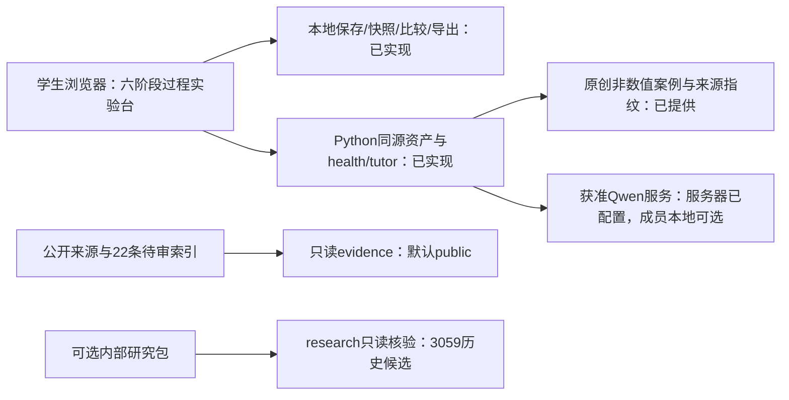
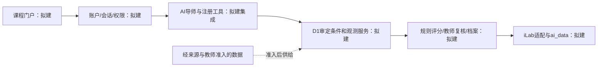

# 申报书第6、7栏技术准备稿

版本：v1，2026-10-20，TASK-014。用途：供团队拼装申报书和两位指导老师审阅；不是已提交定稿。技术核查由Cano执行，human_reviewed=false。校内流程、课程负责人、资质、等保、软著及签章由两位指导老师负责；LJX提供本稿与技术附件、接收其确认结果。

本稿对照本地附件1第6/7栏，原表定位和SHA见本次报告引用的source-form-provenance.json；不再沿用旧计划中“前端为空、尚未接入模型”的表述。依据以[当前状态](../../../STATE.md)、[架构](../../../ARCHITECTURE.md)、[工作台设计](../../design/workbench.md)、[双浏览器记录](../../operations/browser-acceptance.md)和[接收清单](handoff_acceptance.md)为准。原技术基线中的容量目标继续保留为目标，不能填成测量结果。

## 6. 实验教学相关网络及安全要求

### 6-1 网络条件要求

**S6.1.1 客户端带宽与测试服务——可填准备文案**

现有原型通过浏览器加载本项目HTML/CSS/JavaScript、非数值案例内容及装置示意图；学生操作与练习记录在浏览器本地进行。实时AI通过同源后端按需请求已有模型服务。客户端最低带宽、首页加载时延及模型响应分位数尚未实测，不填写“已支持100 Mbps”或其它保证值。正式服务需补充客户端到服务端的带宽测试入口及实际链路验证；当前尚无带宽测试服务。

**S6.1.2 同时在线与排队服务——可填准备文案**

当前标准库后端提供资产及受限AI辅导接口。AI分支配置为最多2个同时上游请求、每来源IP每分钟12次请求、45秒上游超时；这是程序配置，不是负载试验结论。超限返回明确提示，尚未实现等待队列或队列位置展示。50在线会话/10轻量并发请求是规划目标，实际可支持人数、吞吐与P95时延均待负载试验，不作为现有能力承诺。排队提示服务须独立补建并验收。

### 6-2 用户操作系统要求

**S6.2.1 计算机操作系统及版本——可填准备文案**

网页面向现代桌面浏览器，成员本地启动需要Git与Python3.10+标准库。TASK-013的公开配置在GitHub Windows/macOS/Linux三平台完成启动检查、Python/JS守卫及包式CLI验收；这证明工程入口可运行，不替代各操作系统图形浏览器或完整课程验证。本轮Chrome、Edge图形渲染自动走查在Ubuntu24.04.4 LTS、x86_64上执行，确切版本/范围见双浏览器记录。Windows11及特定macOS桌面浏览器的实体设备验收仍待补，正式支持版本按实际试测填写。

**S6.2.2 其他终端操作系统及版本——可填准备文案**

现有界面采用响应式布局，已覆盖375px手机尺寸与768px平板尺寸的浏览器视口测试。Android/iOS系统版本、触屏、系统输入法与移动端下载/持久化尚未在实体设备验收，暂不填写支持的移动系统版本。

**S6.2.3 是否支持移动端——填写状态**

当前可表述为“已具备响应式过程原型，移动实体设备与完整课程支持待验”。原表“是/否”正式选择留待移动端实际测试及指导老师确认，不以视口截图自动勾“是”。

### 6-3 用户非操作系统软件配置要求

**S6.3.1 浏览器——可填准备文案**

本轮使用Google Chrome和Microsoft Edge官方稳定渠道Linux发行包，在独立浏览器进程中逐步走查三条路线、三个视口，记录品牌版本/UA、页面、持久化、记录导出和异常恢复，并保存录像。具体版本和结果以[双浏览器记录](../../operations/browser-acceptance.md)为准；不以通用Chromium替代品牌测试，也不将本轮代理自动走查称为老师或成员真人签收。IE/360/Firefox未测试，暂不勾选；Edge在原表“其他”栏写明名称与已测版本。

**S6.3.2 是否需要特定插件——可填准备文案**

现有原型为原生HTML/CSS/ES模块，不需要浏览器专用插件。正式表可按当前功能填写“否”；插件名称、容量、下载链接为“不适用”。Playwright及其浏览器包仅用于研发QA，不是学生使用前置。

**S6.3.3 其他终端软件及下载服务——可填准备文案**

计划通过浏览器直接访问，无专用终端应用安装包。当前没有移动应用或对应软件下载服务；移动终端实际支持范围仍待验，不承诺未测试软件。学生浏览器访问与开发成员本地Python启动要求分开填写。

### 6-4 用户硬件配置要求

**S6.4.1 计算机硬件——可填准备文案**

现有前端为二维网页与装置示意，学生客户端不运行分子模型训练或本地大模型，不要求专用独立GPU。客户端CPU、内存、显存、可用磁盘的最低配置尚未做设备下限试验，暂写“待实测核定”；浏览器练习记录由本地存储保存并可导出。不能将共享Ubuntu服务器的96逻辑CPU/125 GiB内存填为学生最低配置。

**S6.4.2 其他终端硬件——可填准备文案**

已做375px及768px视口工程检查；手机/平板的最低处理器、内存、存储、触控与输入要求待实体设备测试，不预填硬件下限或“全移动端支持”。

### 6-5 用户特殊外置硬件要求

**S6.5.1 计算机外置硬件——可填准备文案**

现有过程原型使用常规计算机、浏览器与输入设备，无需可穿戴设备、头显、传感器或实体实验仪器。过程动画和取样标签不对应真实设备控制。

**S6.5.2 其他终端外置硬件——填写状态**

当前设计无特殊外置硬件，准备稿填“无”；移动设备完整支持仍按6-2/6-4的待验范围处理，不通过此项扩大支持承诺。

### 6-6 网络安全

**S6.6.1 定级备案——指导老师提供**

是否完成、备案主体、证书编号、备案证明附件均由两位指导老师对接校内责任方后提供。LJX仅交付系统架构、服务边界、部署与技术测试材料，不代填“已备案”或虚构编号。当前准备稿标“待指导老师提供适用于本实验/承载平台的依据”；原表正式是/否与主体选择等待真实材料。

**S6.6.2 等保测评——指导老师提供**

两位指导老师提供适用的正式测评结论页、实验与平台隶属关系页等材料，并确认与本项目的适用关系。当前同源请求校验、静态目录限制、限流和凭据隔离是工程措施，不能替代等保测评结论。准备稿保留“待指导老师提供”，不把LJX列为校内手续办理人。

## 7. 技术架构及主要研发技术

### S7.01 系统架构与简要说明

**可填准备文案：**现有系统由原生浏览器实验台、Python标准库同源服务、非数值案例元数据和可选实时AI辅导组成。学生独立选择路线、设计方案与对照、演练操作/取样、检查缺失证据、记录反思。练习状态保存在当前浏览器源，后端不提供账户、正式成绩或跨设备档案。全量历史研究池由独立只读证据入口按research配置访问，不是学生网页运行依赖。当前无审定观测，quantitative_result始终null。

**后续课程与平台架构（以下全部拟建）：**

实际界面与规划课程分别表达，不能把六阶段过程演练称为完整24步课程或把后续图中服务写成已运行。

### S7.02 开发技术

已采用HTML5、CSS、JavaScript ES模块与Python标准库HTTP服务；原型含二维过程动画和原创装置示意。未采用VR/AR/MR、三维引擎、实体仪器控制或云渲染；对应选项不勾选。技术选择以当前代码为证据，不按机器上安装的软件推断已采用技术。

### S7.03 开发工具

Git2.43.0；Python开发解释器3.13.13、LAN系统解释器3.12.3；Node22.23.2/npm10.9.8及Playwright1.64.1用于工程验证。普通运行只需Python3.10+，不需npm构建。ffmpeg用于本轮QA录像转码。Unity/3D建模工具及专用插件未采用。以上版本为2026-10-20本机快照，非学生软件下限。

### S7.04 服务器CPU、内存、磁盘、显存与GPU

现有Ubuntu主机是共享承载，不是本项目独占资源。2026-10-20只读核实：96逻辑CPU、总内存约125.37 GiB，项目所在文件系统总容量约875.64 GiB；可用空间和可用内存属于瞬时共享状态，不作为项目配额填写。历史观测两张RTX PRO6000保留在实施基线，本轮未重新测GPU。网页/证据核验组件没有GPU运行依赖；实时AI由所有者提供的既有上游服务执行，未核定本项目GPU配额。

规划起始软预算为4逻辑CPU/8 GiB内存/20 GiB存储，尚非已分配或负载验证结果。正式表中的项目资源配置由实际配额确定后填写，不抄共享整机容量为本项目配置。

### S7.05 服务器操作系统

已测承载为Linux：Ubuntu24.04.4 LTS、x86_64；本轮内核6.17.0-23-generic。常驻服务为本项目systemd用户服务，8766端口，当前只读状态active。本次未重新安装/重启该服务，不将其等同于校级公开部署或长期SLA。

### S7.06 数据库及版本

研究池已有SQLite只读索引；Python3.13环境的sqlite3模块版本3.53.1，索引完整性核验见TASK-013。该版本是本机模块快照。学生状态当前存localStorage，未部署教学会话/成绩数据库；MySQL、SQL Server、Oracle不勾选。后续账户/成绩数据库仍待设计与验收。

### S7.07 其他硬件或多服务器备注

现有本项目HTTP服务运行于共享Ubuntu主机，实时模型调用所有者提供的既有服务，当前没有新购服务器或独占多机承诺。开发成员可在自己的计算机独立运行无密钥流程。备份、长期维护、配额与正式服务责任须在后续部署安排中明确，本稿不代替两位指导老师的校内承载结论。

### S7.08 云渲染

现有原型不使用云渲染；浏览器本地渲染HTML/CSS与二维示意。大模型远程推理不等于图形云渲染。

### S7.09 实验品质与响应参数

现有界面以二维DOM/CSS渲染，三维模型面数、贴图细分、每帧渲染次数为“不适用”。本轮按1536×1024、768×1024、375×812视口检查布局、输入、保存/恢复及完整过程；不是实体屏幕/移动设备认证。动作反馈时延、首屏加载P95、刷新率与最低帧率没有专项测量，暂记待测，不虚构60fps或秒级保证。操作动画持续时间不代表反应时间或速率。

### S7.10 AI模型层

- 基础模型：已有LAN后端配置模型标识qwen3.8-flash-next-iq3_s。本轮health读取为configured=true；配置与真实推理成功是不同证据，实际请求结果见双浏览器记录。密钥只在本项目private配置，浏览器不持有上游凭据。
- 垂类模型：未采用独立垂类训练模型。当前非数值案例上下文不应命名为已训练领域模型。
- 专项模型：未采用独立产率/动力学/评分预测模型，不自训基础模型。无配置的成员本地显示不可用，不妨碍过程练习；模型标识不证明权重哈希或许可已另行核实。

### S7.11 智能体与受控工具

当前已实现上下文辅导与独立证据守卫，模型不调用外部文件/命令，也不注册以下六个科学工具。六项为后续接口设计，现有部分算术/表单校验不等于已完成同名科学工具。

| 拟议工具 | 当前工程基础 | 尚需完成的准入/接口 |
| --- | --- | --- |
| validate_structure | 分子身份仍待同事/教师核验 | 结构/糖位点与反应方向验证、版本与人审依据 |
| retrieve_case_evidence | 已有只读案例/来源索引和非数值摘要 | 经授权证据段落检索、逐条定位和可公开字段，不把摘要当已核全文 |
| search_candidate_routes | 三条候选路线可选 | 限域检索、候选与适用域；历史搜索代码不是当前已上线工具 |
| check_experiment_design | 已有装配、单位、取样和必填校验 | 经教师确认的设计判据、结构化工具接口与审查日志 |
| run_supported_simulation | 当前无观测时拒绝数值 | 审定条件—观测和支持域服务，超范围拒绝；不生成伪曲线 |
| calculate_material_balance | 已有体积×浓度投料算术 | 基准/单位/稀释与完整物料衡算依据及教师容差，非当前科学计算器 |

后续工具参数结构化、权限最小化、输出绑定来源/版本/支持域；不允许任意shell、任意文件读取或模型代签教师结论。

### S7.12 智能应用与AI过程统计

已有应用：按当前路线、阶段、学生方案和非数值来源上下文提供解释/追问；定量无证据时拒绝；失败/未配置明确显示；学生先独立保存理由，AI不修改方案。拟建应用：准入数据上的过程分析、教师量规、能力画像与正式课程评价；AI不独立决定成绩。

以下是本项目的拟议统计合同，尚未接入iLab，不声称已完成官方接口认证：

| 字段 | 定义与计数规则 | 失败、重试与当前状态 |
| --- | --- | --- |
| ai_call_count | 统计后端真正向上游发出的模型请求次数。点击、health轮询、无配置、输入拒绝、限流拒绝、无数据直接拒绝不计 | 发出后超时/失败仍算一次尝试；重试若再发出则新增一次，须另带request_id/attempt去重与成败字段。当前无正式汇总采集，不把未知累计量填0 |
| ai_models_used | 记录实际发出请求的模型标识，版本/权重指纹仅在确有证据时写入 | health配置名仅证明配置存在，不自动加入“已使用”；失败尝试可按attempt日志保留。模型权重哈希未知则null，不能由名字推定 |
| ai_usage_scenarios | 按实际发生阶段登记方案建议/过程反馈/反思等场景 | 同一attempt按当时上下文记一次；工具拒绝与测试fixture另标，不混成真实模型使用。场景字典/会话绑定待联调 |

当前浏览器对话与阶段记录可作工程基础，未建立服务端持久统计、正式学习者身份或成绩映射。真实模型答复、证据守卫与QA模拟失败分别呈现。

## 拼装前仍需补充的输入

1. 指导老师：6-6适用资质、校内承载与正式提交字段；不由LJX代办。
2. HYK：文献摘录与T-H2可支持观测范围；收到后更新D1相关表述，不能自动升格教师批准。
3. ZYT/LYW：案例/24步/反馈与量规；收到后核对页面与脚本，按[接收清单](handoff_acceptance.md)留版本与缺项。
4. 技术验证：并发/带宽/队列、实体Windows/macOS/移动端与课程完整性。当前已执行的品牌浏览器和跨平台CLI结果分别引用，不互相替代。

三状态门仍为历史研究候选、22/22待教师审核、公众教学发布not_started；本稿准备完成不等于其余输入已到或申报已定稿。
