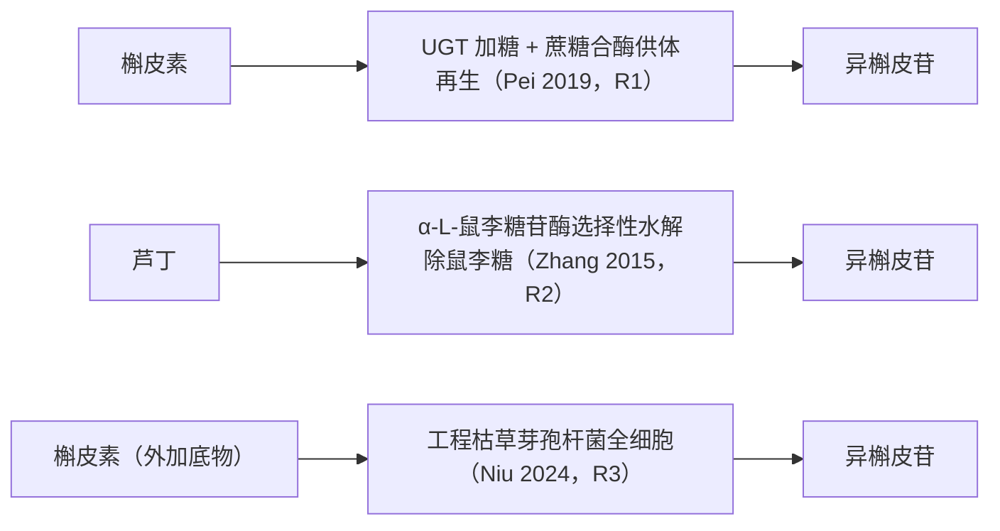
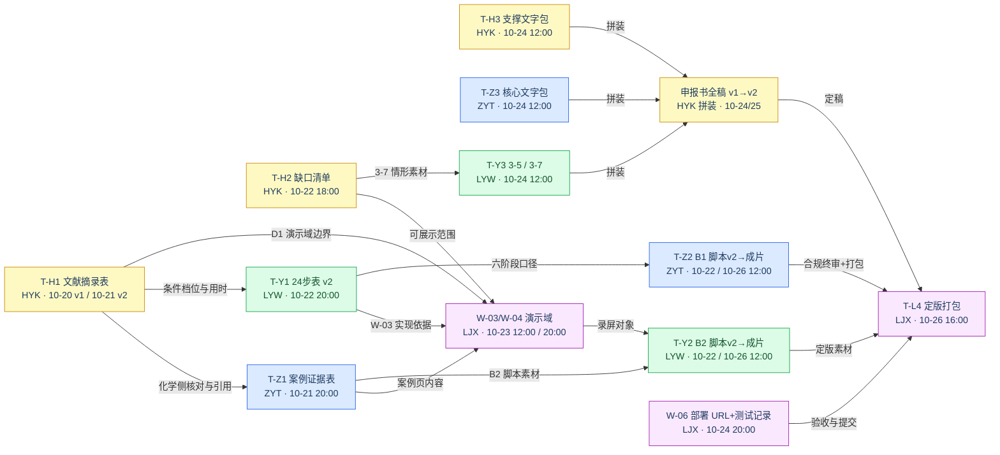
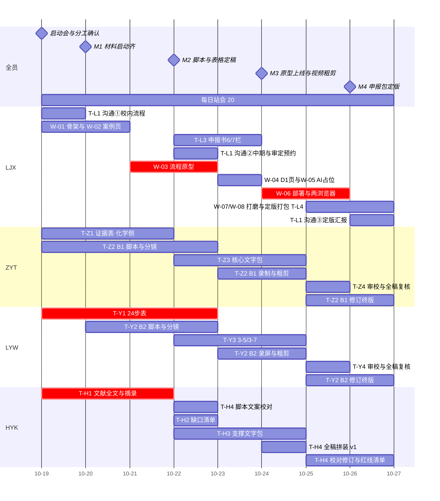

# FlavoGlycoLab 申报阶段分工与执行方案（2026-10-19 → 10-26）

> **版本**：v2.1（2026-10-18 补充版）——在 v2 基础上按项目指导文件（附件1/附件2/可行性调研）强化 **AI 赋能主线**：新增 §1.4 逐条对照表与统一口径；同步更新 T-L3、T-Z3、T-Y1、T-H3、W-05、T-Z2、T-Y2 与验收清单。v2（10-17）变更：任务卡化＋交付关系＋验收标准。
>
> **性质与授权**：本文件按用户 2026-10-17 会话指令（human_direct）编制，是申报冲刺期的分工计划，不是已批准 TASK，不改变 research_evaluation / teaching_case_review / public_teaching_release 三个状态门，也不代替教师审定与校内申报决定[^rule]。方向与科学设计全部沿用已获指导教师认可的汇报（FlavoRetro_to_FlavoGlycoLab.html）及可行性调研 2026-10-15 版，本方案不新增化学事实。文件按 p10ns 工作区惯例存放于 `docs/p10ns/261019/`，属工作计划，不登记为状态真值文件。
>
> **工作量口径假设（推断，非事实）**：四人按全投入估算，每人 8 人日，合计 32 人日；每人预留 0.5 机动日。若与课程/考试冲突，在每日 20:00 站会调减并顺延非关键项。

## 2026-10-20执行更新（以此处和STATE为准）

TASK-015按所有者直接命令接入新增文献交接：HYK署名v2.0已本地收到，实际版本/指纹/需补项只在[H01](handoff_acceptance.md#h01本轮接收检查)维护。三篇全文可读，Pei/Zhang旧“仅摘要级”不再是当前阻断；条件冲突、标曲/原始测量、许可及教师审定仍限制D1。新增[data_gap_list.md](data_gap_list.md)是代理准备稿，不能代记HYK的T-H2定稿、LYW的24步表或ZYT案例表已交。下文排程/原验收清单保留，不因本次补充整项勾完。

所有者已明确：校内推荐/沟通、材料与签章、课程负责人与资质、等保和软著等校内事务由两位指导老师负责。LJX只负责技术材料、工程验收和内部交接，原T-L1中的对外事务不再作为学生待办；指导老师姓名和实际结论不预填。

TASK-013已交付完整六阶段过程实验台、可选实时Qwen和克隆即可运行的public配置，旧“前端为空/AI未接”的现状文字只保留为当时快照。六阶段不等于完整24步课程；D1观测、正式评分与iLab仍待完成。当前技术准备见[第6/7栏底稿](shenbaoshu_sections_LJX.md)，14项交接及接入标准见[接收清单](handoff_acceptance.md)，真实会议只记[站会日志](standup_log.md)。原表的后续时间仍为计划，未收到的交付不得标完成。

## 📌 依据与现状

| 依据文件 | 角色 | 对本方案的关键约束 |
| --- | --- | --- |
| 附件1 申报书（docx） | 要求文件① | 11 栏申报表；3-6 栏要求**不少于 20 步学生交互性操作步骤**（含步骤名称/目标要求/合理用时/赋分模型/满分/成绩类型）；3-4 栏四段限字文案（原理 1000 字、核心要素仿真/AI 应用/产业场景各 500 字）；4 特色限 800 字；2-2 团队教学限 500 字[^fj1] |
| 附件2 征集说明（pdf） | 要求文件② | "未来健康"方向；真数据、真仿真、真交互；交互步骤 ≥20 步；自主/授权软件与软著；有效链接网址直指实验；等保二级与 ilab-x 接口联通；11-23 起社会开放[^fj2] |
| 可行性调研 20261015（md） | 方向依据 | 主推荐题名、三条文献路线、24 步方案、D1 数据底线、简介视频 ≤3 分钟 / 教学视频 ≤5 分钟 MP4[^feas] |
| 老师汇报 HTML（29 页） | 已认可方向 | S13 三路线、A03/A04 步骤细目、S14—S16 教学与 AI 设计[^deck] |
| STATE / ROADMAP | 现状与边界 | 22/22 候选待教师审、教学模块均为 scaffold、双轨并行、F0 校内资格未核实[^state] |

**现状一句话**：证据池与治理已完成工程验收；教学系统未建设，`frontend/` 为空脚手架；国家在线申报窗口 10-13—11-20（调研快照），校内截止未检得。本方案把 **10-26 设为团队内部定版截止**，10-27 起进入校内流程[^state][^feas]。

## 🧪 虚拟实验设计：三条文献路线落到 24 步

### 1.1 案例主线：异槲皮苷，同一产物、三条生物反应路线

案例为槲皮素-3-O-β-D-葡萄糖苷（异槲皮苷），须与芦丁（3-O-芸香糖苷）、其他位点异构糖苷及 EMIQ 严格区分；三条路线产物关联但**不共享动力学参数**[^case][^pub]。

| 路线 | 文献 / DOI | 生物反应 | 体系 | 教学与申报书角色 | 数据现状 |
| --- | --- | --- | --- | --- | --- |
| R1 酶促加糖 | Pei 2019（10.1007/s10600-019-02712-9） | 槲皮素 + UDP-葡萄糖 →（糖基转移酶 UGT）异槲皮苷；蔗糖合酶（Susy）由蔗糖 + UDP 再生 UDP-葡萄糖 | 体外酶偶联 | 主实验路线之一：步骤 09—10 选酶与糖供体再生，13—20 条件/取样/定量 | 仅摘要级，条件与原始数据待取[^pei] |
| R2 选择性去糖 | Zhang 2015（10.1007/s10529-015-1792-6） | 芦丁 →（重组 α-L-鼠李糖苷酶选择性水解除末端鼠李糖）异槲皮苷 | 体外单酶水解 | 对照路线：步骤 03 判反应方向、09—12 中作"水解无需糖供体"的教学对照点 | 仅摘要级，动力学线索待全文核对[^zhang] |
| R3 工程菌转化 | Niu 2024（10.1186/s12934-024-02390-5） | 外加槲皮素 →（工程化枯草芽孢杆菌全细胞）异槲皮苷；工程点：糖供体供给↑、底物降解↓、产物水解↓ | 微生物全细胞生物转化 | 模块 B 衔接：步骤 21—22 比较工程菌方案，解释"表达了酶却未高产" | 开放全文已见；数据集提取与许可待审[^niu] |

_下图为三条路线的反应关系；R1、R2 为体外酶法（模块 A 主实验），R3 为全细胞转化（模块 B 衔接）。_

### 1.2 与既有 24 步框架的映射（申报书 3-6 步骤表底稿）

24 步框架、每步"学生动作—反馈—先要补齐什么"已在可行性调研 §7.2 与汇报附录 A03/A04 给出，本方案直接沿用并落到申报书 3-6 表格[^feas][^deck]：

| 步骤 | 学生实质动作 | 三文献 / 数据依赖 | 反馈与数据规则 |
| --- | --- | --- | --- |
| 01—02 | 确认目标产物并标注 3-O-葡萄糖连接；区分芦丁 / 异槲皮苷 / 位点异构 / EMIQ | 结构库 | 教师审定对照后给确定判据 |
| 03 | 判别候选反应属加糖（R1/R3）还是去糖（R2） | 反应卡片 | 键变化检查 |
| 04 | 给来源卡分级，选出能支持本案例的证据 | 21 条历史命中 + 3 篇文献卡 | 指出证据可靠性与缺口 |
| 05—06 | **先于 AI** 独立选路线并保存理由；登记可检验假设 | — | 保存调用 AI 前的原始方案 |
| 07—08 | 调用受限于案例证据的 AI/检索，比较并**拒绝一条超范围建议** | 受控检索 | 建议附来源；拒绝理由反馈 |
| 09 | 选择经审定的酶/体系：R1（UGT+Susy）或 R2（鼠李糖苷酶） | 体系卡：底物范围与限制 | 身份与适用域反馈 |
| 10 | 糖供体决策：UDP-葡萄糖 + 再生（R1），或解释水解无需供体（R2） | 物料约束 | 路径特异检查 |
| 11—12 | 设空白 / 无酶 / 灭酶对照；输入底物、体积、单位并算投料 | 对照与投料规则 | 单位、摩尔量与守恒检查 |
| 13—14 | 选数据支持的缓冲/溶剂/pH 与温度/酶量档位 | **仅文献实际测过的档位** | 命中→D1 重放；未测→明确拒绝数值 |
| 15—17 | 设计单变量比较、确定取样时点、运行基线虚拟实验 | 取样与分析方案 | 有来源标签的结果展示 |
| 18—20 | 辨认底物/产物/未知峰并积分；按标准曲线算浓度；算转化率、收率、选择性并核对物料衡算 | 色谱/标准曲线证据 | 可复算公式与版本化容差 |
| 21—22 | 选有文献依据的工程菌方案（R3），比较供体供给 / 底物降解 / 产物水解三类改造的真实数据 | Niu 2024 数据 | 数据不足时降为文献案例分析，不伪装实时发酵 |
| 23—24 | 在支持域内修改一次方案并比较；提交证据约束的结论、未解问题与下一实验设计 | — | 量规反馈 + 教师复核入口 |

### 1.3 数值底线（D1，写进申报书与视频的统一口径）

- 所选条件**有经审定的原始观测覆盖**时，才显示该次实验的观测值并标注来源、条件与单位；**未覆盖时明确提示"没有对应实验数据，暂不能给出产率"**，保留学生假设[^feas]。
- 零值、缺失、推断、机器核验、真人审定分开登记；不从终点产率反推时间曲线或色谱[^feas][^case]。
- 申报书与视频一律按"**已有 / 拟建**"分列表述；10-26 前若教师审定未完成，网站 D1 页与视频使用明确标注"**教学演示子集（待教师审定）**"的占位，不显示任何虚构数值。

### 1.4 AI 赋能主线（对照项目指导文件逐条落实）

_本节把教育部两个要求文件与可行性调研 §9—§10 中关于"人工智能+"的条款逐条映射到任务卡，作为申报书、两个视频、网站的统一口径。核心立场：**AI 引导而不代做、建议必附来源、数值只来自已审定观测、AI 不单独决定成绩**[^fj1][^fj2][^feas]。_

| 指导文件条款 | 要求原文要点 | 本项目落实 | 落点任务卡 |
| --- | --- | --- | --- |
| 附件2 标准一「数据驱动，模型赋能」 | 以真实数据为牵引，依托大模型推动验证性操作向综合设计性、研究探索性实验转变；真数据、真仿真、真交互 | 学生**先独立保存方案、再与 AI 受限建议比对**（步骤 05—08）；数值结果仅由 D1 服务按已审定观测重放（步骤 13—20） | T-Z3（仿真/AI 500 字）、T-Y1、W-04 |
| 附件2 标准三「创新教学，智能引导」 | 实验前辅助方案设计与资源推荐；实验中实时分析数据并提供智能反馈；实验后支持成果优化、反思改进与创新路径规划 | AI 导师**三段式**：**前**（方案提示、文献资源、缺对照预警）→ **中**（单位/对照/异常提醒，"底物下降≠产物生成"）→ **后**（假设—观测对比、反思与下一实验建议） | T-Z3、W-05、T-Z2/T-Y2 镜头 |
| 附件2 标准四「赋分评价，能力画像」 | 过程评价与结果评价结合，构建全过程赋分评价模型，形成动态能力画像与成长档案 | 五维画像：结构判断、证据审查、方案设计、定量计算、反思改进；AI 使用次数计入学习过程分析，不按"少用 AI=高分"计分 | T-Y1（赋分模型）、T-Y3 |
| 附件2 标准五「伦理安全，可信可控」 | AI 伦理与安全贯穿全过程；建立算法公平性评估机制与伦理审查机制 | AI 不产生实验数值、不单独决定成绩；越界建议必须拒绝并给理由；提示与工具调用留痕审计；统一提示权限、申诉与教师复核通道 | T-H3（伦理段）、T-H4 红线、T-Z3 |
| 附件1 3-4「人工智能应用设计（500 字）」 | 说明 AI、大模型、智能体、知识库等在实验引导、智能反馈、数据分析、能力评价四方面的具体应用方式 | ZYT 专段撰写：按"前—中—后"三段展开并覆盖四个作用点，写明智能体＋知识库形态 | T-Z3 |
| 附件1 第 7 栏「人工智能技术应用」 | 模型层（基础/垂类/专项模型）、智能体、智能应用 | 如实按"拟建"填三层：基础模型拟接入（名称待定，不自训）；智能体＝案例知识库＋受控工具；智能应用＝AI 导师/过程反馈/能力画像 | T-L3 |
| 实验空间 2026 接口 ai_data | ai_call_count、ai_models_used、ai_usage_scenarios 等字段如实统计（2022 接口继承＋AI 应用过程统计） | 设计统计口径：导师模型请求计数、模型名称/版本清单、场景标签（方案建议/过程反馈/反思）；10-26 后联调阶段接入 | T-L3（口径表）、W-05（计数演示） |
| F §9.2 受控工具集 | validate_structure、retrieve_case_evidence、search_candidate_routes、check_experiment_design、run_supported_simulation、calculate_material_balance | 作为 AI 导师**唯一工具白名单**写入申报书与 W-05 样例；工具只接受结构化参数，无任意 shell/文件访问权限 | T-Z3、T-L3、W-05 |

**AI 赋能统一口径（申报书/视频/网站同一套话）**：大模型导师是"会追问的助教"——实验前帮学生发现缺对照与证据缺口，实验中检查单位与异常，实验后引导比较假设与观测；其建议 100% 附来源与适用范围，查不到依据时明确说明；**产物量、色谱与评分依据一律来自真实数据服务与教师量规**。

## 🔁 四人交付关系

_节点为交付物（标注负责人与截止日），边为交付方向；颜色区分成员。所有交接在当日 20:00 站会确认到人。_

### 交接矩阵（每条含截止时刻与缺席预案）

| # | 交付物 | 交付 → 接收 | 截止时刻 | 接收后用途 | 缺席预案 |
| --- | --- | --- | --- | --- | --- |
| 1 | T-H1 文献摘录表 v1 / v2 | HYK → ZYT、LYW、LJX | 10-20 20:00 / 10-21 20:00 | 证据表核对、24 步条件档位、D1 演示域边界 | 停留摘要级，缺失字段照常登记，不阻塞下游 |
| 2 | T-Z1 案例证据表 v1 | ZYT → LYW、HYK、LJX | 10-21 20:00 | B2 素材、缺口对照、W-02 案例页内容 | 用 deck S13 内容兜底，标注来源 |
| 3 | T-Y1 24 步表 v1 / v2 | LYW → LJX、ZYT、HYK | 10-21 20:00 / 10-22 20:00 | W-03 实现依据、B1 六阶段口径、校对 | 用 F §7.2 原表兜底 |
| 4 | T-Z2 B1 脚本 v1 / v2 | ZYT → LYW、HYK、LJX | 10-21 12:00 / 10-22 20:00 | 互审、文案校对、合规终审、录制底稿 | 录制推迟至 10-24 上午，剪辑压缩到 1 天 |
| 5 | T-Y2 B2 脚本 v1 / v2 | LYW → ZYT、HYK、LJX | 10-21 20:00 / 10-22 20:00 | 同上 | 同上 |
| 6 | W-03/W-04 演示域 | LJX → LYW | 10-23 12:00（01-12 段）/ 20:00（全 24 步+D1 页） | B2 录屏 | B2 先录 01-12 段，13 起画面用分镜静态图补 |
| 7 | 申报书分段稿 ×3 | ZYT / LYW / HYK 互相 → HYK 汇总 | 10-24 12:00 | 拼装全稿 v1 | 逾期段由 HYK 建占位框并标红，站会追责 |
| 8 | 申报书全稿 v1 | HYK → 全员 | 10-24 20:00 | 交叉审校 | — |
| 9 | 审校意见（ZYT 化学 / LYW 教学 / HYK 文案 / LJX 合规） | 全员 → 各修订人 | 10-25 12:00 | 修订为 v2 | 意见未到视为"无意见"，留痕 |
| 10 | 申报书 v2 + 治理红线检查报告 | HYK（红线起草）→ LJX（复核）→ 全员 | 10-25 18:00 / 20:00 | 定稿 | — |
| 11 | B1 / B2 粗剪 → 修订版 → 终版 | ZYT、LYW → 全员 → LJX | 10-24 20:00 / 10-25 20:00 / 10-26 12:00 | 审校、打包 | 终版可降为"修订版+遗留问题清单" |
| 12 | W-06 部署 URL + 两浏览器测试记录 | LJX → 全员 | 10-24 20:00 | 验收、沟通③、B2 成片画面核对 | 先交内网 URL，公开 URL 列为待办 |
| 13 | T-L4 定版包（含 SHA256 与交付清单） | LJX → 指导老师 / 校内 | 10-26 16:00 | 提交 | 缺件如实列入清单并注明原因 |

## 🗂️ 任务卡（内容 · 交付物 · 时间 · 依赖 · 验收标准）

> 约定：文件默认落在 `docs/p10ns/261019/` 下；每条验收标准均为可勾选项，10-26 验收逐条核对；标注"待教师审定/待校内确认"是合法状态，**编造数值不是**。

### LJX（统筹 · 网站与打包 · 对外沟通）— 8.0 人日

#### T-L1 老师沟通①②③（0.5+0.5+0.5 人日）

- **内容**：①10-19 校内五项确认：推荐流程与责任老师、校内真实截止与材料清单、课程归属与负责人（供 3-3/2-2）、等保二级与平台承载安排、软著办理路径；②10-22 中期汇报（脚本+证据表+网站截图各 1 页）+ 预约化学/生物催化教师案例审定 + 确认申报书"已有/拟建"表述尺度；③10-26 定版汇报 + 确认提交方式与政审/学术评价/盖章时间表。
- **交付物**：`communication_log.md`（三次沟通各一节：时间、参与人、结论、待办）＋沟通②的 1 页中期汇报材料。
- **时间**：10-19 / 10-22 / 10-26 16:00—18:00；结论当日 20:00 前回填。
- **交付关系**：结论 → 全员（站会通报）；课程归属 → HYK（T-H3）；截止变化 → LJX 自用（日程校准）；审定时间窗 → ZYT/LYW（后续案例审定排期）。
- **验收标准**：
  - [ ] 五项信息每项有"已确认（内容）/未确认（追查计划+责任人+期限）"结论，无空白
  - [ ] communication_log 每节含时间、参与人、结论、待办四要素
  - [ ] 沟通②拿到 ≥1 位审定教师的可确认时间窗并记录
  - [ ] 若校内截止早于 10-26，当日站会重排日程并更新本文件版本号
  - [ ] 不替老师作答、不假推校内结论

#### T-L2 网站搭建 W-01—W-08（5.0 人日，详见第 5 节逐步验收）

- **交付物**：`frontend/` 代码 + 部署 URL + 测试记录（录屏/截图归档）。
- **验收标准**：W-01—W-08 各步验收清单全部打勾；输入依赖 T-Y1 v2（W-03）、T-Z1（W-02）、T-H2（W-04）按交接矩阵到位。

#### T-L3 申报书第 6、7 栏（0.5 人日）

- **内容**：6-1 带宽与并发（写实测计划与"承诺值待实测"，不编数）；6-2 操作系统/移动端；6-3 两浏览器；6-4 硬件配置；6-5 特殊外置硬件（无）；6-6 等保（按沟通①结论填"是/否/办理中"）；7 栏：架构图＋开发技术（HTML5）＋工具＋运行环境＋**人工智能技术应用三层（对照 §1.4）——模型层：基础模型拟接入、名称待定，不自训基础模型；智能体：案例知识库＋受控工具白名单（validate_structure、retrieve_case_evidence、search_candidate_routes、check_experiment_design、run_supported_simulation、calculate_material_balance）；智能应用：AI 导师／过程智能反馈／能力画像——并附 ai_data 统计口径表（ai_call_count、ai_models_used、ai_usage_scenarios 的定义与计数规则，标注"待联调接入"）**。
- **交付物**：`shenbaoshu_sections_LJX.md`（含架构图 Mermaid 或导出 PNG＋ai_data 口径表）。
- **时间**：10-22 启动 → 10-24 12:00 交 HYK。
- **交付关系**：输入 = 沟通①结论、T-H2、§1.4 统一口径；输出 → HYK 拼装。
- **验收标准**：
  - [ ] 6-1 至 6-6 每小栏非空，或带"待校内确认"标注
  - [ ] 架构图含数据流：学习者门户 → 会话/权限 → AI 导师/受控工具 → D1 数据服务 → 评分/档案 → iLab 适配器（与 F §9.1 一致）
  - [ ] AI 三层按"拟建"如实填写，含六项受控工具白名单；不虚构已接入的模型名称
  - [ ] ai_data 三字段口径表齐全（定义＋计数规则＋"待联调"标注）
  - [ ] 不出现虚构等保证书、虚构并发数

#### T-L4 定版打包与提交（1.0 人日）

- **内容**：汇总申报书终稿、两 MP4、网站部署说明、四份支撑文件（证据表/缺口清单/24 步表/沟通记录）、治理红线检查报告；生成交付清单与 SHA256。
- **交付物**：`docs/p10ns/261019/release/`（定版目录）+ `release/交付清单.md`（逐文件 SHA256）。
- **时间**：10-26 16:00 完成打包，18:00 前随沟通③移交。
- **验收标准**：
  - [ ] 清单与实际文件一一对应，SHA256 全部校验通过
  - [ ] 版本冻结说明写明"此后修改须走变更记录"
  - [ ] `data/raw`、`data/derived`、`data/private` 内容一律不在包内
  - [ ] 缺件（如有）如实列出并注明原因，不补假件

### ZYT（介绍视频 · 申报书核心文字 · 化学侧证据）— 8.0 人日

#### T-Z1 案例证据表·化学侧（1.5 人日）

- **内容**：①分子身份卡 5 张：异槲皮苷、芦丁、槲皮素、EMIQ、代表性位点异构糖苷（中英文名、SMILES、分子式、分子量、糖连接方式）；②21 条历史命中清单（记录 ID、来源文件、反应方向、是否酶促、与主案例关系、去重结论、状态）；③R1/R2 反应卡（反应式、酶名与来源、糖供体、辅助蛋白、条件域逐字段"已知值/缺失"）。
- **交付物**：`case_evidence_table.md`（可附 csv）。
- **时间**：10-19 启动 → 10-21 20:00 v1。
- **交付关系**：输入 = T-H1 v1（10-20 20:00）、`data/registries/case_admission.csv`；输出 → T-Y2（B2 素材）、T-H2（缺口对照）、T-L2 W-02（案例页）、T-Z3（原理引用）。
- **验收标准**：
  - [ ] 21 条逐条登记，无一条缺 source_id 或状态
  - [ ] 全部状态为 candidate/待审；出现"已审/通过"字样即不通过
  - [ ] 5 张分子卡的 SMILES 与分子量经第二来源（PubChem 或文献）交叉核对一致，并记录核对来源
  - [ ] 化学未知字段一律写"缺失（原因）"，无推测值
  - [ ] LYW、HYK 在 10-21 站会确认接收并留痕

#### T-Z2 B1 介绍视频（2.5 人日）

- **内容**：脚本（0:00—0:20 真实问题；0:20—1:20 学生做什么=24 步六阶段；1:20—2:10 **AI 赋能与数据分工（对照 §1.4：实验前方案提示与资源推荐、实验中实时分析与智能反馈、实验后反思与创新路径规划＋能力画像；AI 建议必附来源，数值只来自已审定观测）**；2:10—2:45 已有 vs 拟建；2:45—3:00 课程定位与团队）＋分镜（镜头号/画面/口播/字幕/时长）＋录制＋剪辑字幕。
- **交付物**：`b1_script_v2.md`、`b1_storyboard.md`、`video/b1_intro_final.mp4`。
- **时间**：脚本 v1 10-21 12:00 → v2 定稿 10-22 20:00 → 录制 10-23 → 粗剪 10-24 20:00 → 修订版 10-25 20:00 → **终版 10-26 12:00**。
- **交付关系**：输入 = T-Y1（六阶段口径）、T-Z1（案例表述）、§1.4 统一口径、HYK/LYW 审校意见；输出 → HYK 校对、LYW 互审、LJX 终审打包。
- **验收标准**：
  - [ ] 时长 ≤180s（±2s）；MP4（H.264）、≥1080p、≥25fps
  - [ ] 字幕与口播逐句一致（抽查 ≥10 句零错），无错别字
  - [ ] 未实现功能出现时口播含"拟/计划"或画面带"拟建"角标；全片常显"教学原型（演示，数据待教师审定）"角标
  - [ ] 明确呈现 AI"前—中—后"三段引导与能力画像（对照 §1.4），且与"AI 不出数值、不单独决定成绩"口径一致
  - [ ] 无任何未加标注的产率/条件数值
  - [ ] HYK、LYW 意见在 `proofread_log.md` 各 ≥3 条且全部闭环

#### T-Z3 申报书核心文字包（2.5 人日）

- **内容**：3-1 简介（400—600 字）、3-2 教学目标（知识/能力各 ≥3 条）、3-4(1) 实验原理 ≤1000 字＋知识点列表 ≥8 个、3-4(2) 核心要素仿真设计 ≤500 字、**AI 应用设计 ≤500 字（对照 §1.4：按"实验前—实验中—实验后"三段展开，覆盖引导/智能反馈/数据分析/能力评价四个作用点；写明"智能体＋案例知识库"形态、六项受控工具白名单、AI 使用记录进入过程评价）**、4 特色 ≤800 字（以"AI 引导不代做＋真数据底线"为特色主线之一）。
- **交付物**：`shenbaoshu_sections_ZYT.md`（每段末附实际字数）。
- **时间**：10-22 启动 → 10-24 12:00 交 HYK。
- **交付关系**：输入 = T-Z1、T-H1、F §14.2 草稿、§1.4 统一口径；输出 → T-H4 校对与拼装。
- **验收标准**：
  - [ ] 字数全部达标（原理 ≤1000、三段各 ≤500、特色 ≤800）
  - [ ] 科学论断 100% 带来源锚点（如 [证据表 R1] [F§6] [deck S13]），无锚点句 ≤2 句/段
  - [ ] 原理覆盖三路线区别、D1 数值底线、AI 四层分工、物料衡算
  - [ ] AI 应用设计"前—中—后"三段齐全，覆盖附件1 四个作用点，并明确"AI 不出数值、不单独决定成绩"
  - [ ] AI 段与 W-05 演示样例、T-Y1 赋分模型口径一致
  - [ ] 3-2 与 24 步表成绩类型对应一致
  - [ ] "已有/拟建"逐段自查对照 F §14.1 并打勾

#### T-Z4 交叉审校（1.0 人日）

- **内容**：审 T-Y2 脚本（镜头级）与 T-Y1 步骤表化学准确性；10-25 参与全稿化学复核。
- **交付物**：`review_log.md` ZYT 小节。
- **时间**：意见 10-22 12:00 前给出；全稿复核 10-25 12:00 前。
- **验收标准**：[ ] B2 脚本逐镜头给"通过/修改意见"；[ ] 24 步表 24/24 步核对酶名、反应方向、供体、单位；[ ] 意见全部闭环（提出→修改→复核签名）；[ ] 机动 0.5 人日用于修稿（不计验收）。

### LYW（操作视频 · 24 步步骤表 · 教学过程文案）— 8.0 人日

#### T-Y1 24 步步骤表（3-6 格式，2.5 人日）

- **内容**：把 F §7.2＋deck A03/A04 重排为附件1 3-6 表：步骤序号、步骤名称、目标要求、合理用时、目标达成度赋分模型、满分、成绩类型；另写 3-6(2) 交互性步骤详细说明三段（AI 赋能详细说明 / 产业场景与工作任务融入说明 / 详细操作说明）。
- **交付物**：`24step_table_3-6.md`＋`shenbaoshu_sections_LYW.md`（含 3-6(2)）；10-26 前填入申报书 docx 表格。
- **时间**：v1（全 24 步）10-21 20:00 → v2（含赋分模型）10-22 20:00。
- **交付关系**：输入 = T-H1（条件档位/用时参照）、T-Z1（步骤 04 来源卡）、附件1 3-6 表头；输出 → LJX W-03（实现依据）、ZYT B1（六阶段口径）、T-Z4（审校）、HYK（拼装）。
- **验收标准**：
  - [ ] 步数 = 24（≥20 达标），全部为实质交互（登录/加载/翻页/看视频不计步）
  - [ ] 每步用时 3—15 分钟，合计 ≤180 分钟
  - [ ] 每步赋分模型含可复算规则（公式或量规要点），全表满分合计 = 100
  - [ ] 成绩类型仅取 {操作成绩, 实验报告, 预习成绩, 教师评价}
  - [ ] 学生动作与 F §7.2 逐条一致，未偏离已认可框架；13—20/21—22 步注明"依据已审定/演示子集数据"
  - [ ] 3-6(2) 三段齐全，AI 段落与 T-Z3 的 AI 应用设计表述一致
  - [ ] AI 赋能段逐区段写明 AI 触点（05—08 比对与拒绝超范围建议、13—20 过程反馈、24 反思改进）与 AI 使用记录进入过程评价的方式（对照 §1.4）

#### T-Y2 B2 操作视频（3.0 人日）

- **内容**：脚本＋分镜（镜头号/页面动作/口播/字幕）；按镜头单录屏走 24 步主链；剪辑。
- **交付物**：`b2_script_v2.md`、`b2_shotlist.md`、`video/b2_operation_final.mp4`。
- **时间**：脚本 v1 10-21 20:00 → v2 10-22 20:00 → 录屏 10-23 14:00 起（W-03 01-12 段 12:00 就绪）→ 粗剪 10-24 20:00 → 修订 10-25 20:00 → **终版 10-26 12:00**。
- **交付关系**：输入 = W-03/W-04 演示域（LJX）、T-Z1（表述）、T-Y1（步骤与赋分）；输出 → T-Z4 审校、T-H4 校对、LJX 打包。
- **验收标准**：
  - [ ] 覆盖：01—04、09—12、17—20 全程画面；05—08、21—24 至少各 1 个关键画面
  - [ ] 必含"未测条件 → 拒绝数值"分支演示 ≥8 秒
  - [ ] 时长 ≤180s（±2s）、≥1080p MP4；鼠标动作可辨识（必要时放大光标）
  - [ ] 画面常显"教学演示子集（待教师审定）"角标；无未标注数值
  - [ ] 镜头单含 AI 触点镜头 ≥4 个（05—08 方案比对、拒绝超范围建议、17—20 过程反馈、24 反思，至少各 1 个）
  - [ ] HYK、ZYT 意见各 ≥3 条闭环（`proofread_log.md`）

#### T-Y3 申报书 3-5/3-7（1.0 人日）

- **内容**：3-5 实验教学过程与方法（4 学时 ×45 分钟，写明每学时任务、步骤区间、师生动作、反馈方式）；3-7 实验结果与结论（≥4 类情形：条件命中显示真实观测 / 未测条件拒绝数值 / 对照异常或失败 / 工程菌比较与局限）。
- **交付物**：`shenbaoshu_sections_LYW.md` 内 3-5/3-7 节。
- **时间**：10-22 启动 → 10-24 12:00 交 HYK。
- **交付关系**：输入 = T-Y1、T-Z1、T-H2；输出 → HYK 拼装。
- **验收标准**：[ ] 学时合计 =180 分钟且步骤区间覆盖 01—24 无重叠遗漏；[ ] 3-7 每类情形标注数据来源类型（实测 / 演示子集 / 拟建）；[ ] 无编造数值；[ ] 与 T-Y1 用时口径一致。

#### T-Y4 交叉审校（1.0 人日）

- **内容**：审 T-Z2 脚本（镜头级）与 T-Z1 证据表（分子身份与表述）；10-25 参与全稿教学复核。
- **交付物**：`review_log.md` LYW 小节。
- **时间**：意见 10-22 12:00 前；全稿复核 10-25 12:00 前。
- **验收标准**：[ ] B1 脚本逐镜头给"通过/修改意见"；[ ] 证据表 5 张分子卡＋21 条命中全部过目并给出结论；[ ] 意见全部闭环；[ ] 机动 0.5 人日（不计验收）。

### HYK（文献搜取 · 文案 · 生物侧证据 · 校对拼装）— 8.0 人日

#### T-H1 三篇文献全文与字段级摘录（2.5 人日）

- **内容**：Pei 2019、Zhang 2015、Niu 2024：①获取全文（校园网/馆际/开放获取），记录获取状态；②字段级摘录：书目信息、体系类型、酶名与来源、宿主与改造点、糖供体、底物与浓度、缓冲/pH/温度/酶量/体积、取样时点、对照与重复、分析方法（色谱/标准曲线）、已测条件×结果（值+单位+原文定位）、失败/零值/缺失、许可与获取方式、摘录人与日期。
- **交付物**：`literature_extraction_table.md`（三篇分表，字段统一）。
- **时间**：v1（书目+获取状态+已知字段）10-20 20:00 → v2（全字段）10-21 20:00。
- **交付关系**：输出 → T-Z1（化学侧核对）、T-Y1（条件档位）、T-H2、T-Z3/T-Y3（引用）。
- **验收标准**：
  - [ ] 三篇均有获取状态行（全文 PDF / 摘要级 + 原因）
  - [ ] Niu 2024 完成开放全文全字段摘录
  - [ ] 每个数值字段含：值＋单位＋原文定位＋摘录日期；无定位数值不得入表
  - [ ] 三表体系隔离，跨体系比较只出现在"教学对比"备注列
  - [ ] Pei/Zhang 若停留摘要级，明确分列"摘要可支持 / 不可支持"字段
  - [ ] 酶名、菌株名、改造点拼写与原文一致（自查一遍）

#### T-H2 数据缺口清单（1.0 人日）

- **内容**：对照 F §8.2 最低字段逐项标"可补 / 不可补 / 待授权"；映射到 24 步（影响哪些步骤）；R1/R2 全文拿不到时的降级预案（条件域以 Niu 开放全文为主，R1/R2 降为路线对照）。
- **交付物**：`data_gap_list.md`。
- **时间**：10-22 18:00。
- **交付关系**：输出 → LJX（W-04 可展示范围）、T-Y3（3-7 情形）、LJX 沟通②（审定材料清单）。
- **验收标准**：[ ] 覆盖 F §8.2 全部最低字段条目；[ ] 每条缺口标注受影响步骤号（映射 01—24）；[ ] 有降级预案与触发条件；[ ] 无"都能补上"的乐观表述。

#### T-H3 申报书支撑文字包（2.0 人日）

- **内容**：2-2 团队教学情况 ≤500 字（师资信息留 [待老师确认] 占位）；3-3 实验课时（与 24 步 180 分钟一致）；3-8 面向学生要求；5 在线支持与服务（承诺值标"拟承诺，以学校核定为准"）；8 持续建设服务计划（五年表，每年 ≥2 条可核动作）；9 知识产权（如实填"拟申请/受理中"，流水号留空）；3-4 产业场景融入 ≤500 字（仅用文献真实体系表述，不虚构企业合作）；**AI 伦理与公平性措施段（附件2 标准五，对照 §1.4）**：AI 不产生实验数值、不单独决定成绩，越界建议拒绝并留痕，统一提示权限、申诉与教师复核通道，算法公平性自查——写入 4 特色或 5 栏合适位置（与 ZYT 分工：HYK 只写伦理与公平，不重复功能描述）。
- **交付物**：`shenbaoshu_sections_HYK.md`。
- **时间**：10-22 启动 → 10-24 12:00。
- **交付关系**：输入 = 沟通①结论、T-H1、§1.4 统一口径；输出 → 自用拼装（T-H4）。
- **验收标准**：[ ] 2-2 ≤500 字、产业场景 ≤500 字（附字数）；[ ] 五年表 5 行每行 ≥2 条具体可核动作；[ ] 3-3 与 T-Y1 总用时、F §7.3 学时表一致；[ ] 9 栏不虚构证书/流水号；[ ] 老师个人信息全部为占位符；[ ] 5 栏承诺值带"拟承诺"标注；[ ] 产业场景无虚构企业且带来源锚点；[ ] AI 伦理与公平性段齐全、覆盖附件2 标准五要点且与 T-Z3 不重复。

#### T-H4 文案校对与全稿拼装（1.5 人日＋脚本校对 0.5 人日）

- **内容**：①10-22 上午校对 B1/B2 脚本文案（术语/通顺）；②10-24 收三路分段稿（ZYT/LJX/LYW，12:00）拼装全稿 v1（按附件1 栏目顺序，逐栏标负责人与状态）；③10-25 汇总修订为 v2；④治理红线核对清单（数值引用有锚点 / 已有拟建分列 / 无虚构 / 待审标注齐全）。
- **交付物**：`proofread_log.md`、`assembly/shenbaoshu_draft_v1.md` → `v2`、`governance_checklist_1025.md`。
- **时间**：脚本意见 10-22 12:00；全稿 v1 10-24 20:00；红线清单草稿 10-25 18:00（交 LJX 复核）；v2 10-25 20:00。
- **交付关系**：输入 = 交接矩阵 #7；输出 → 全员审校 → LJX 定稿打包。
- **验收标准**：
  - [ ] 全稿栏目顺序与附件1 一致，每栏有内容或"待校内确认"标注，无空栏
  - [ ] 术语全文一致并附术语表：异槲皮苷/芦丁/槲皮素/UGT（糖基转移酶）/蔗糖合酶/α-L-鼠李糖苷酶/枯草芽孢杆菌/D1 重放
  - [ ] 数值引用 100% 有来源锚点；治理红线 5 条逐条勾验
  - [ ] 每条校对意见闭环（修改或写明驳回理由）
  - [ ] 机动 0.5 人日（不计验收）

## 📅 八日日程与里程碑（含交接时刻）

_甘特条为日历跨度（可并行）；人日见任务卡；10-24/25 为周末，按全投入假设排期。_

| 日期 | 交接与事件（时刻） | 各人关键产出 | 检查点（20:00 站会） |
| --- | --- | --- | --- |
| 10-19 一 | 09:00 启动会（30 分钟） | LJX 沟通①（18:00 前）＋W-01；ZYT T-Z1 启动＋B1 大纲；LYW T-Y1 启动；HYK T-H1 启动 | 沟通①结论回填；任务板认领齐 |
| 10-20 二 | 20:00 T-H1 v1 交付（#1） | HYK 摘录表 v1；ZYT 证据表推进＋B1 初稿；LYW 24 步表推进＋B2 大纲；LJX W-01 验收→W-02 | **M1**：摘录表 v1、脚本大纲、W-01 三样齐 |
| 10-21 三 | 12:00 B1 脚本 v1（#4）；20:00 T-H1 v2、T-Z1 v1、T-Y1 v1、B2 脚本 v1（#2/#3/#5） | 互审分发；LJX W-03 启动 | 三个 v1 齐，互审与校对分派完成 |
| 10-22 四 | 12:00 审校意见截止（ZYT/LYW/HYK→脚本）；18:00 T-H2（#6 前置）；20:00 脚本 v2＋T-Y1 v2 定稿（#4/#5/#3） | 三路申报书分段稿开写；LJX 沟通②＋T-L3 | **M2**：脚本定稿、步骤表定稿；审定时间窗确认 |
| 10-23 五 | 12:00 W-03 01-12 可演示段→LYW；18:00 W-03 全 24 步；20:00 W-04/W-05（#6） | ZYT 录 B1；LYW 14:00 起录 B2；HYK 提醒收分段稿 | 录制素材齐；分段稿逾期预警 |
| 10-24 六 | 12:00 分段稿×3→HYK（#7）；20:00 W-06 URL＋测试记录（#12）、全稿 v1（#8）、B1/B2 粗剪（#11） | HYK 拼装；LJX 部署与两浏览器验证 | **M3**：URL 可访问、全稿 v1、粗剪齐 |
| 10-25 日 | 12:00 审校意见截止（#9）；18:00 红线清单草稿；20:00 申报书 v2（#10）、视频修订版 | 全员交叉审校与修订 | v2 齐；红线复核完成 |
| 10-26 一 | 12:00 视频终版＋申报书定稿（#11）；16:00 T-L4 定版包＋SHA（#13）；16:00—18:00 沟通③；18:00 验收清单全勾 | LJX 主导；全员收尾 | **M4**：申报包定版并移交 |

## 🌐 网站搭建步骤（W-01—W-08，LJX 实现按任务卡验收）

`frontend/student`、`frontend/teacher` 现为空占位，从第 1 步起算；页面内容由 ZYT（案例页）、LYW（步骤页）、HYK（关于页）供给。

| 步骤 | 内容与验收标准 | 日期 | 人日 | 输入依赖 |
| --- | --- | --- | --- | --- |
| W-01 | 信息架构与骨架：首页/案例页/24 步流程页/数据查询页/AI 助手页/关于页。 验收：[ ] 六路由可达且导航高亮正确 [ ] 两浏览器 console 无报错 [ ] 标题/描述与项目名一致 [ ] 375px 宽不破版 [ ] 404 兜底页 | 10-19~20 | 0.75 | — |
| W-02 | 案例页：结构区分（5 分子）＋三路线卡片＋证据卡组件。 验收：[ ] 三路线卡片与 deck S13、T-Z1 逐字段比对 ≥10 处一致 [ ] 证据卡显示来源/状态（candidate/待审）/SHA 前 8 位 [ ] 无未审定数值 | 10-20~21 | 0.75 | T-Z1 v1（10-21 20:00） |
| W-03 | 24 步交互流程原型：状态机＋每步输入控件与反馈位。 验收：[ ] 24 步全部可走通（待做/进行/完成三态） [ ] 反馈文案与 T-Y1 v2 一致 [ ] 数据依赖步（04/09/13—20/21—22）带"待教师审定"角标 [ ] 01-12 段 10-23 12:00 可演示 [ ] 刷新后进度不丢失 | 10-21~23 | 1.25 | T-Y1 v2（10-22 20:00） |
| W-04 | D1 条件查询演示页。 验收：[ ] 已测条件→"来源实验数据·教学演示子集"卡（条件+单位） [ ] 未测条件→"无对应实验数据，暂不能给出产率"＋保存假设按钮 [ ] 可展示范围与 T-H2 一致 [ ] 无未标注数值 | 10-23 | 0.75 | T-H2（10-22 18:00） |
| W-05 | AI 助手演示页（§1.4 三段式）。 验收：[ ] "实验前/中/后"三段各 ≥1 条预置样例（前：方案提示＋缺对照预警；中：单位与异常提醒；后：假设—观测对比与反思建议） [ ] 每条样例带来源标注并出现受控工具名（六工具中 ≥3 个） [ ] 含 1 条"拒绝超范围建议"样例 [ ] 显示 AI 使用计数演示（ai_call_count 风格） [ ] 页面明标"演示环境，未接入真实模型" | 10-23 | 0.25 | §1.4 口径 |
| W-06 | 部署上线。 验收：[ ] 有效 URL 直指实验入口（非文件下载） [ ] Chrome、Edge 最新版各完整走通 01-12 一遍并录屏 [ ] 并发排队提示可触发（录屏 ≥15s） [ ] 部署说明含启动与回滚命令 | 10-24~25 | 0.75 | W-04/W-05 |
| W-07 | 打磨：按 B2 镜头单补画面。 验收：[ ] B2 镜头单全程无阻塞 [ ] ≥10 张截图归档 [ ] bug 清零或注明遗留 | 10-25 | 0.25 | B2 镜头单 |
| W-08 | 定版打包。 验收：[ ] 版本冻结说明 [ ] 部署说明入 release/ [ ] SHA256 清单 | 10-26 | 0.25 | 全部 |

> 合计 5.0 人日。关键路径：W-03（10-23 12:00 可演示段）→ B2 录屏 → 粗剪 → 终版。

## 🎬 视频制作规格（细则并入 T-Z2 / T-Y2 任务卡）

- **分镜模板**（b1/b2 通用）：镜头号｜起止秒｜画面/页面动作｜口播逐字稿｜字幕｜角标与标注。
- **技术规格**：MP4（H.264）、≥1080p、≥25fps、≤180s±2s；字幕内嵌、字体 ≥24pt 等效、安全区留边。
- **统一红线**：未实现功能口播称"拟"或画面加"拟建"角标；全片常显"教学原型（演示，数据待教师审定）"；未测条件不出数值，必须拍到"拒绝数值"分支（B2）；不使用未标注的文献产率数值；B1 与 B2 口径互相一致（六阶段说法以 T-Y1 v2 为准）。
- **互审链**：B1 ← LYW＋HYK 审；B2 ← ZYT＋HYK 审；LJX 合规终审；意见留痕于 `proofread_log.md`。

## 🗣️ 沟通节点验收（并入 T-L1）

| 节点 | 时间 | 交付物 | 验收标准 |
| --- | --- | --- | --- |
| 沟通① | 10-19 | 五项信息结论表 | 五项每项有结论或追查计划；当日 20:00 入 log |
| 沟通② | 10-22 | 1 页中期汇报（脚本状态/证据表/网站截图）＋审定预约 | ≥1 位教师给出可确认审定时间窗；"已有/拟建"表述尺度获口头认可并记录 |
| 沟通③ | 10-26 16:00 | 定版包移交＋提交安排 | 提交方式明确；政审/学术评价/盖章时间表落纸；release 目录移交路径确认 |

## ⚠️ 红线、风险与停止条件

**治理红线（触发即整改，不设例外）**[^rule]：

1. 不虚构实验数值：摘要级文献的产率与条件不入申报书与视频；未审定数据一律标"待教师审定"。
2. 三门不合并：候选 ≠ 教师通过 ≠ 可公开；21 条历史命中不得预填已审。
3. 原始来源字节不动；`data/raw`、`data/derived`、`data/private` 不入 Git、不入交付包。
4. 视频/网站不得把未实现功能表现成已运行；演示数据带"教学演示子集"标注。
5. 申报书"实验已开设期次/已服务人数"如实填写：尚未开设即写拟开设计划。
6. AI 表述不越界：不宣称自主训练大模型或精准预测酶活/药效；AI 不产生实验数值、不单独决定成绩；AI 调用与提示如实记录（对照 F §14.1 与 §1.4）。

| 风险 | 影响 | 对策 | 责任 |
| --- | --- | --- | --- |
| Pei/Zhang 仅摘要级 | 步骤 13—20 支持域变窄 | HYK 10-20 前取全文；不成 → 按 T-H2 降级预案（Niu 为主域，R1/R2 路线对照） | HYK |
| 教师审定赶不上 10-26 | D1 页无审定数据 | "教学演示子集＋待审"标注；申报书按拟建表述；审定走沟通②预约 | LJX |
| 等保/软著/政审/学术评价属学校流程 | 校内提交受阻 | 沟通①③确认路径；无法落实 → 按 ROADMAP G0 记 HOLD，材料留 B 轨复用 | LJX |
| W-03 延期挤压 B2 | 关键路径延期 | W-03 先交 01-12 段；B2 先录可演示段，13 起用分镜静态图 | LJX / LYW |
| 人员时间冲突 | 人日缺口 | 每人 0.5 机动日；站会即时调减非关键项 | LJX |

**停止条件**：任一风险导致"只能靠编造数据或虚标状态才能按期交付"时，当日站会决定降范围或如实延期，并在 PROGRESS 留痕[^rule]。

## ✅ 10-26 验收清单（18:00 前逐项打勾）

- [ ] 申报书全稿覆盖附件1 第 1—11 栏全部可填项；3-6 表填满 24 步，每步含赋分模型与成绩类型，全表满分 = 100
- [ ] 3-4 栏四段文案与 4 特色、2-2 字数全部达标并附字数
- [ ] 两个视频终版 ≤3 分钟 MP4，验收标准（T-Z2/T-Y2）逐条打勾
- [ ] 网站 W-01—W-08 验收逐条打勾；有效 URL、两浏览器录屏、排队提示演示齐备
- [ ] 案例证据表、缺口清单、文献摘录表按各自验收标准打勾
- [ ] 治理红线检查报告（governance_checklist_1025.md）经 LJX 复核签字
- [ ] 交接矩阵 13 条全部"已交付/按预案降级"留痕
- [ ] 三次沟通记录完整，提交安排确认
- [ ] 3-4 AI 应用设计按"前—中—后"三段撰写，覆盖附件1 四个作用点（引导/智能反馈/数据分析/能力评价）
- [ ] 第 7 栏 AI 三层（模型层/智能体/智能应用）与 ai_data 口径按"拟建"如实填写
- [ ] AI 伦理与公平性措施写入并覆盖附件2 标准五
- [ ] W-05 呈现 AI"前—中—后"三段样例与 AI 使用计数演示
- [ ] release/ 定版包：交付清单与 SHA256 校验通过，版本冻结

---

## 脚注

[^rule]: AGENTS.md（仓库根）：三状态门、来源保护与 TASK 纪律。`/home/ljx/FlavoGlycoLab/AGENTS.md`
[^state]: STATE.md：截至 2026-10-16 的当前事实（22/22 待审、模块 scaffold、公开边界）。`/home/ljx/FlavoGlycoLab/STATE.md`
[^roadmap]: ROADMAP.md：A 轨 F0—F4 申报前置门与四态决策。`/home/ljx/FlavoGlycoLab/ROADMAP.md`
[^fj1]: 附件1《2026年度"人工智能+"虚拟仿真实验教学项目申报书》：3-6 步骤表（≥20 步）、3-4 限字文案、第 6/7 栏技术要求。`docs/research/附件1_2026年度"人工智能"虚拟仿真实验教学项目申报书(1).docx`
[^fj2]: 附件2《2026年度"人工智能+"虚拟仿真实验教学项目征集说明》：未来健康方向、≥20 步、真数据真仿真真交互、软著、等保二级、ilab-x 接口、11-23 开放。`docs/research/附件2_2026年度"人工智能"虚拟仿真实验教学项目征集说明(1).pdf`
[^feas]: FlavoRetro_FutureHealth_Feasibility_20261015.md：主推荐题名、§6 三条路线、§7.2 24 步、§8.2 数据最低字段、§8.3 D1、§12.2 人日、§14.1 已有/拟建、§2 视频时长。`docs/research/FlavoRetro_FutureHealth_Feasibility_20261015.md`
[^deck]: FlavoRetro_to_FlavoGlycoLab.html：已获指导教师认可的方向汇报（S13 三路线、A03/A04 步骤细目、S14—S16 设计）。`docs/p10ns/261017/261017/FlavoRetro_to_FlavoGlycoLab/FlavoRetro_to_FlavoGlycoLab.html`
[^case]: docs/cases/isoquercitrin/README.md：案例状态 pending_teacher_review；三体系参数不共享。
[^pub]: data/registries/publication_sources.csv：Pei2019/Zhang2015 摘要级、Niu2024 开放全文已见及各自准入限制。
[^pei]: Pei 等 2019（UGT + 蔗糖合酶供体再生制备异槲皮苷，仅摘要级核验）：<https://link.springer.com/article/10.1007/s10600-019-02712-9>
[^zhang]: Zhang 等 2015（重组 α-L-鼠李糖苷酶由芦丁制备异槲皮苷，水解反应）：<https://pubmed.ncbi.nlm.nih.gov/25724715/>；DOI: 10.1007/s10529-015-1792-6
[^niu]: Niu 等 2024（工程枯草芽孢杆菌转化外加槲皮素，开放全文已见）：<https://link.springer.com/article/10.1186/s12934-024-02390-5>
