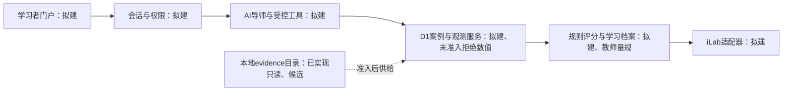

# 2026申报实施基线、Ubuntu承载与条件矩阵

> 2026-10-20职责与现状更新（TASK-014）：校内沟通、推荐/签章、课程负责人、等保/权属/软著等校内事项由两位指导老师负责；下文旧矩阵中LJX相关校内追问角色改为技术材料配合与接收结论，不再要求学生代办。原主机快照/容量目标仍保留其日期和未测状态。当前已有实验台/实时AI及6/7栏逐字段准备稿见[shenbaoshu_sections_LJX.md](../../p10ns/261019/shenbaoshu_sections_LJX.md)；本文件继续是主机/预算/目标/条件的唯一基线，旧“未部署/未接模型”仅描述2026-10-18当时状态。

本文件是TASK-006交付的唯一活跃申报技术/条件汇总，不是学校批复、教师审定、正式申报书或部署回执。确认日期：2026-10-18（Asia/Shanghai）。实际来源见末尾索引；所有未执行性能指标保持`null`。

## 1. 已确认输入与执行边界

| 输入 | 当前基线 | 证据与边界 |
| --- | --- | --- |
| 推荐资格 | 有 | O1：所有者会话确认，可据此筹备；不冒充已收书面通知或最终推荐名额 |
| 校内截止 | 2026-10-27 | O1；具体时刻、提交路径和签章办理余量未提供，不默认当日23:59 |
| 内部定版 | 2026-10-26；原计划16:00打包、18:00内部验收 | O1＋P1，内部检查点，不是国家截止 |
| 课程用途 | 拟用于化学生物学实验课程 | O1；不表示已开课、实际服务人数已发生或量规已审定 |
| 教学授权 | 后续拟定 | O1；持权方/范围/签署时间待落实，教学使用与公开再分发分开 |
| 目标承载主机 | 当前这台Ubuntu服务器 | O2明确选择；H1核实配置，取代前序“平台后续确定” |
| 本轮实施 | 只读主机清点＋实施基线/交接/验收资料 | O2授权TASK-006，不自动执行007/008、安装、服务启动、外部联系或部署 |

证据类型：`owner_statement`＝所有者确认；`local_probe`＝本次只读观测；`local_registry`＝本地候选登记；`planning_target`＝本项目目标；`official_reference`＝官方资料。`verified`仅指该行所陈述事实有相应证据，不跨越科学、教师、许可或发布门。`partial/unknown/blocked`分别表示部分有据、缺证、已有明确阻断；未回复不等于明确否定。

## 2. Ubuntu主机实况与项目资源预算

H1观测时点：2026-10-18 02:21:57 +08:00（原始UTC为2026-10-17 18:21:57）。这是一次快照，空闲资源随共享负载变化。命令不打印IP、主机名、MAC、用户、序列号或进程命令。原始脱敏证据位于本项目`temp/task006-execution/host-probe.json`，不进入Git；可用同目录`probe_host.py`只读重查。

| 类别 | 本次观测（local_probe） | 本项目使用边界 |
| --- | --- | --- |
| 系统 | Ubuntu 24.04.4 LTS，x86_64 | 已选主机的实际系统，不再填“Linux版本待定” |
| CPU | 双路Intel Xeon Gold 5418Y；每路24物理核、每核2线程；整机48物理核/96逻辑CPU；当前进程亲和范围96逻辑CPU | 首期软预算4个逻辑CPU；未设置配额、未独占，不能将96写成本项目并发容量 |
| 内存 | 总134,616,776,704 B＝125.37 GiB；MemAvailable 28,572,307,456 B＝26.61 GiB | 首期软预算8 GiB，未预留；部署前复查当前可用量，不能用125.37 GiB作为独占资源 |
| 交换空间 | 总约8 GiB，快照剩余20,480 B | 几乎用满的快照不证明正在持续换页或已经OOM；后续部署前复核，不在本TASK清理/调整 |
| 项目所在文件系统 | ext4，整卷940,211,900,416 B＝875.64 GiB；可用194,853,818,368 B＝181.47 GiB | 起始代码/日志/数据库20 GiB软预算，100 GiB仅扩展目标、未划分；不复制私有原件作为网页资产 |
| 存储介质 | 物理SSD型号/属性：unknown | ext4不证明SSD；原讨论“100 GiB SSD”不是已分配事实 |
| GPU | 2张NVIDIA RTX PRO 6000 Blackwell Server Edition；每卡nvidia-smi报告97,887 MiB显存；驱动580.142 | 主机实际有GPU，首期本项目CPU-only、不预留GPU；不因此宣称部署本地模型 |
| 限额 | 未读到探测路径中的cgroup v2 cpu.max/memory.max值 | 有效cgroup上限仍unknown，不推定无限额；亲和CPU也不等于资源保证 |
| 基础工具 | 当前python3为3.13.13，Python SQLite模块3.53.1；Node22.23.2、npm10.9.8、Git2.43.0；Docker CLI29.8.0 | 工具存在不表示应用数据库、容器或教学服务已配置 |
| 服务/浏览器 | 当前PATH未找到nginx、psql、sqlite3 CLI、Chrome、Edge、Chromium；nginx/docker/postgresql的systemctl查询均inactive、返回码4 | 不据此断言整机绝无容器/浏览器；未测试Docker daemon，未查其它工作区或浏览器缓存，无两浏览器验收 |
| 监听概况 | 快照80/443未见TCP监听；8000/8080/8443已有监听；8765未见监听 | 不接管现有端口、不保留8765；监听状态不证明公网可达、域名/TLS/防火墙或发布许可 |

单位：GiB＝2³⁰ B，MiB＝2²⁰ B；申报表若使用十进制GB须标明换算，不混用整机物理核、逻辑CPU与项目软预算。硬件清点不是压力测试，不能据此宣布50人已可用。

## 3. 技术目标与替换条件

适用范围为HTML5轻量课堂原型：文本/证据卡、步骤输入、离散查表、规则计算。50人是规划场景，不是选课人数或现有用户量；目标不含50路高清视频、本地大模型、实时3D、复杂研究搜索。视频按需加载，后续媒体承载单独核定。

| 目标ID | 目标（planning_target） | 当前实测 | 后续验收／替换方式 |
| --- | --- | --- | --- |
| T01 | 50活跃会话、最多10个同时轻量请求；4逻辑CPU/8 GiB/20 GiB起始软预算 | capacity=null；资源未隔离 | 代表性会话负载持续30分钟，记录场景、请求组合、资源与失败；不把50会话当50个重任务 |
| T02 | 客户端可用下行≥10Mbps；服务器可用出口100Mbps目标 | client_bandwidth=null；egress_bandwidth=null | 校内代表性链路与服务出口实测；未来提供真实带宽测试服务，不能使用本机网卡速率替代外网吞吐 |
| T03 | 普通轻量接口P95≤2秒、错误率<1%；本地控件可见反馈≤200ms | api_p95_ms=null；error_rate=null；ui_feedback_ms=null | 在T01负载和记录的客户端环境下测量；HTTP失败与超时计入分母，不排除慢样本 |
| T04 | 冷加载首屏可操作≤5秒、压缩首屏资源≤1 MiB；后续路由≤2秒 | cold_load_ms=null；first_payload_bytes=null；route_ms=null | 规定设备、10Mbps链路与50会话场景；记录缓存、版本，排除明确按需视频但不漏算首次必要资产 |
| T05 | Windows11＋Chrome/Edge验收时当前稳定版；无专用插件目标 | browser_acceptance=null | 实际两浏览器各走01—12及拒绝/保存分支，记录版本；两Chromium实例不代替Chrome与Edge |
| T06 | 375px起响应式浏览；全课程移动端支持待定 | mobile_full_flow=null | 24步触控/输入/保存/查看完成实测后再勾支持；响应式截图不代表移动端实验验收 |
| T07 | 客户端建议64位双核CPU、4 GiB内存、1280×720以上显示、集成显卡 | minimum_client_verified=null | 代表性设备测试后给最低配置，不把服务器资源填入用户硬件栏 |
| T08 | 模型服务拟接入；并发上限2、单次超时30秒，超额排队 | model_requests=0；ai_call_count=0；model_latency=null | 真实接入与配额验证后调整；30秒是超时设置，排队等待另计并可见；预置样例点击不增真实调用数 |
| T09 | 首期CPU-only、无外置实验硬件、不依赖云渲染；100 GiB仅待确认扩展目标 | gpu_reserved=null；disk_reserved=null | 功能/数据量增长或拟用本地模型时重新审查，不能把主机现有GPU当项目已获GPU资源 |

理想传输估算：50×1MiB×8÷100Mbps≈4.2秒，只是忽略协议、争用、处理与渲染的传输下限，不证明T04达标。首屏预算或实测不足时应减资源、错峰/缓存或调整目标，不能伪报响应。

## 4. 附件1第6／7栏字段覆盖

本表按附件1（word/document.xml第281—381段）的14个第6栏项目和12个第7栏项目，共26项检查。组内子字段明确保留；“不适用”只用于拟议方案不需要的字段，正式勾选仍以最终功能和凭据为准。

| 字段ID | 原表内容／子字段 | 可采用的基线或待填内容 | 证据与最终验收 |
| --- | --- | --- | --- |
| S6.1.1 | 客户端带宽、带宽测试服务 | T02网络目标；真实测试服务未实现 | planning_target；链路实测和测试入口后补 |
| S6.1.2 | 同时在线、在线排队提示 | T01：50会话/10轻量请求；T08模型队列另计 | planning_target；负载/队列真实验证，当前非已支持人数 |
| S6.2.1 | 计算机OS及版本 | 目标Windows11桌面；Ubuntu是服务器OS | T05实测后填写支持版本 |
| S6.2.2 | 其它计算终端OS及版本 | 拟响应式浏览；具体Android/iOS版本待测试 | T06，不能随意预填全支持 |
| S6.2.3 | 是否支持移动端 | 全实验支持尚未验收，正式勾选待定 | mobile_full_flow=null，不以375px验收替代 |
| S6.3.1 | 至少两种浏览器 | Chrome、Edge稳定版目标 | T05；服务器未找到浏览器不等于没有可用其它测试机 |
| S6.3.2 | 是否需插件；名称、容量、下载链接 | 拟无需专用插件；名称/容量/链接在该方案下不适用 | 最终原型核对，不能填虚构安装包 |
| S6.3.3 | 其它终端软件及软件下载服务 | 拟浏览器访问、无专用终端软件；下载服务待最终方案判定 | 实际移动端方案确定后填写 |
| S6.4.1 | 计算机CPU/内存/显存/存储等 | T07客户端建议；独立显卡拟不需要，本地存储需求待资产规模核定 | 最低配置未测；不要填H1的整机服务器配置 |
| S6.4.2 | 其它终端硬件 | 移动端最低硬件/屏幕与存储待实测 | T06/T07，明确待测 |
| S6.5.1 | 计算机特殊外置硬件 | 首期拟无 | 最终功能核对，不涉及实体实验设备承诺 |
| S6.5.2 | 其它终端外置硬件有/无及详情 | 首期拟无；如后续需要另填详情 | 最终方案核对 |
| S6.6.1 | 定级备案是/否、主体、证书编号、证明附件 | 未取得本项目适用凭据，状态待确认；主体/编号/附件空缺有标记 | 两位指导老师提供实际平台凭据，LJX仅配合技术材料；Ubuntu版本和TLS不能替代 |
| S6.6.2 | 等保测评是/否、结论页、实验与平台隶属关系页 | 状态待确认；证据页及项目适用关系未取得 | 实际责任方提供正式材料；不把主机已选定记为已认证 |
| S7.01 | 系统架构图及说明 | 下图，全部教学服务为拟建；evidence是当前active包 | P2§9.1、当前ARCHITECTURE |
| S7.02 | 开发技术 | 拟HTML5/CSS/JavaScript，不预填VR/AR/MR/3D已实现 | T01范围；以实现代码再核对 |
| S7.03 | 开发工具 | Git/Python/Node/npm版本见H1；未使用的3D工具不勾选 | 工具可用性不表示课程软件已开发 |
| S7.04 | 服务器CPU/内存/磁盘/显存/GPU | 整机48物理核/96逻辑CPU、125.37 GiB RAM、875.64 GiB卷、2张RTX PRO6000，每卡97,887 MiB；本项目预算4逻辑CPU/8 GiB/20 GiB、GPU不预留 | local_probe＋planning_target分栏；空间未划分，SSD属性未确认 |
| S7.05 | 服务器OS及具体版本 | 当前Ubuntu24.04.4 LTS，x86_64 | H1；不是拟议发行版 |
| S7.06 | 数据库与版本 | 活动候选SQLite索引存在；Python SQLite模块3.53.1可用；教学会话数据库尚未选定/部署 | 模块/证据索引与教学数据库分开，不假填MySQL或PostgreSQL服务 |
| S7.07 | 其它硬件、多服务器备注 | 首期拟使用本机共享资源，无新增服务器承诺 | 承载/容量/备份责任后续落实；已有主机不等于独占 |
| S7.08 | 是否云渲染 | 首期拟不依赖 | T09，功能变化后复审 |
| S7.09 | 实验品质：模型面数/贴图/每帧渲染/反馈/刷新/分辨率等 | 首期轻量HTML5，3D面数/贴图/渲染次数不适用；反馈和加载用T03/T04；刷新率/客户端显示实测待补 | 不虚构60fps或3D性能，资源/时延均待实测 |
| S7.10 | AI模型层：基础/垂类/专项模型 | 基础模型拟接获准服务、名称/版本待定；不自训基础模型；当前未采用独立垂类/专项模型 | 模型服务/许可/配额确定后填写，不把GPU存在当已有模型 |
| S7.11 | 智能体 | 拟案例知识库＋六项受控工具，见下文 | 能力名不是已提供API，参数结构化且无任意shell/文件权限 |
| S7.12 | 智能应用 | 拟AI导师、过程反馈、能力画像；不替学生独立方案/教师评分 | T-Y1量规和真实服务验收后方可写已实现 |

六工具为`validate_structure`、`retrieve_case_evidence`、`search_candidate_routes`、`check_experiment_design`、`run_supported_simulation`、`calculate_material_balance`。全部是拟议内部能力，本TASK未创建API。`ai_call_count`统计真实导师模型请求；`ai_models_used`记录实际模型/版本；`ai_usage_scenarios`记录真实场景。未接模型时为0/空数组/空数组；预置演示另用演示计数，实际接口联调仍待验收，不把本表当最新官方接口完整规范。

## 5. F0—F4条件矩阵与待办

以下各行核对日期均2026-10-18。目标判断点为本项目安排建议，非已确认的人类答复承诺。LJX是计划统筹方，ZYT/LYW/HYK是原方案角色；实际教师/平台/持权人未具名时不代填姓名。

| 条件ID | 问题与当前状态 | status／证据类型与出处 | 责任角色／目标判断点 | A轨影响、B轨复用与下一步 |
| --- | --- | --- | --- | --- |
| F0.01 | 有推荐资格 | verified；owner_statement O1 | LJX；沿已确认输入 | A据此准备，B可复用；后续通知附沟通记录，不反复推翻当前输入 |
| F0.02 | 校内10-27、内部10-26；具体时刻/提交/签章流程待补 | partial；O1＋P1 | LJX；10-19沟通①、最迟10-22复核前置办理时间 | A按10-26完成，签章如需更早即重排；B保留真实行政记录 |
| F0.03 | 拟用化学生物学实验课程 | verified（仅用途意向）；owner_statement O1 | LJX；10-19补课程负责人/开设安排 | A可写拟用，B服务课程设计；不写已开课或已服务人数 |
| F0.04 | 具名课程/审定教师、审核时窗待确认 | unknown；local_registry P3/P4仅见待审状态 | LJX＋实际教师；10-22沟通② | A/B定量教学和评分须实际审定；预约记录不能由Agent生成 |
| F1.01 | 22候选未审：21机器候选、1身份待人审；三体系资料粒度不同 | partial；local_registry P3/P4 | ZYT/HYK按T-Z1/T-H1；10-21 20:00 | A/B都保留候选/缺失；接收定位、去重、方向和条件，不当作已审实验 |
| F1.02 | 无本项目教师批准D1教学真值 | unknown（准入未完成）；P3 22/22待审 | 科学/课程教师＋HYK；T-H2 10-22 18:00，10-25冻结前复核 | A/B数值分支禁用，先拒绝并保存假设；按本节最小数据条件接收 |
| F1.03 | 教学授权后续拟定，公开再分发未获凭据 | unknown；owner_statement O1 | LJX＋持权人；10-22确认路径，最迟实际使用/公开前 | 文档/本地空原型可继续；真实来源展示/再分发按项准入，B保留授权位置 |
| F2.01 | 24步为拟议脚本，未作20实质操作达标认定 | partial；local_registry P2§7.2/P1 | LYW＋课程教师；T-Y1 v2 10-22 20:00 | A/B复用步骤合同；输入/反馈/数据/量规须逐步落地，页面导航不算课程验收 |
| F2.02 | 教师量规、容差/标准曲线/复核流程待审 | unknown；P2§7.3/§8.2 | 课程教师＋LYW；10-22接收、10-25定稿复核 | 阻止正式科学评分，不妨碍工程槽位；AI不单独决定成绩 |
| F3.01 | 承载主机已选，OS/资源已核；项目额度未预留 | partial；owner_statement O2＋local_probe H1 | LJX／主机管理责任人；后续部署前 | A/B可按本机筹备，复查共享内存/磁盘及额度；不自动启服务 |
| F3.02 | 域名/HTTPS/外网路径/带宽/备份监控未验 | unknown；H1仅证明本机端口快照 | LJX／平台网络责任人；10-22确认路径、10-24 W-06前 | 约束真实URL与W-06；不占已有服务端口，不把监听/网卡速率当公网回执 |
| F3.03 | 定级备案、测评、项目隶属关系凭据待补 | unknown；P5原表要求，未取得凭据 | LJX／实际安全责任人；10-22确认路径、正式提交/公开前 | A真实填写6-6，B公开发布同样受约束；不虚构证书 |
| F3.04 | 身份/角色隔离、iLab、真实AI服务未实现 | unknown；STATE/ARCHITECTURE＋H1 | LJX／后续工程与平台人员；联调/发布另立TASK | A/B接口合同可准备，未实施能力写拟建；无密钥/用户数据公开 |
| F3.05 | 软件权属、第三方再分发、软著办理路径待落实 | unknown；O1＋P1沟通① | LJX／权利责任方；10-19确认路径、10-25材料复核 | A/B按真实权利范围使用；本项目原创许可不覆盖所有第三方材料 |
| F4.01 | 四人32人日是原计划假设，非全部投入/预算/运维承诺 | partial；planning_target P1 | LJX统筹全员；每日20:00复核 | A按实际可用时间调减，B复用可审核工件；未收交接不预填已签收 |
| F4.02 | 关键交接到10-26定版，校内截止10-27 | partial；O1＋P1 | LJX；10-22/24/25/26检查点 | A不把27日当提交起点，缺件实列；B保留未完成与降范围 |
| F4.03 | 经费、备份、主机长期维护/持续课程服务责任待明 | unknown；无具名承诺 | LJX／实际运维方；10-22明确路径、正式上线前 | 不承诺已具五年服务；B按需建立运维/升级计划 |

门级摘要：F0部分确认，F1/F2内容与审核待补，F3主机已定但服务/安全未验，F4计划存在但实际资源承诺未齐。本TASK完成不输出“全部GO”或把全部准备重新HOLD；后续只在对应动作所需条件未满足时停该动作。若实际责任方明确无法完成关键路径，再由所有者决定降范围/延期。

### 5.1 一个主案例的D1接收合同

以异槲皮苷候选为首例，Pei2019加糖、Zhang2015去糖、Niu2024工程菌转化独立登记，不共享动力学参数。P4只证明登记粒度：Pei/Zhang=`abstract_only`；Niu=`open_fulltext_seen_in_prior_research`且仍须数据提取/许可审查，不声称本轮精读全文或下载SI。

必须接收并逐项核对：case/source ID、DOI/原位置/SHA；完整底物/产物身份和反应方向；酶/宿主与糖供体；条件档位/投料/体积/单位；对照/重复/取样时点；分析身份/标准品/标准曲线/积分或其它可复核观测；零/失败/缺失/未知峰状态；授权范围/持权依据、数据版本及具名教师/日期。上述观测与审核完成前：numeric_result=null，supported_conditions=null，不显示虚构产率、曲线或谱图；未取得数据不等于研究从未测过。

### 5.2 24步的接收与工程边界

| 步骤范围 | 必须接收的依赖 | 可独立做的工程 | 不能提前认可的内容 |
| --- | --- | --- | --- |
| 01—04 | T-Z1身份/反应/证据与审定 | 候选卡、来源/缺口、输入槽位 | 结构答案、方向和证据评级的教师真值 |
| 05—08 | 独立理由/假设、受控检索及拒绝规则 | 保存05后再看07预置样例，标脚本 | 真实模型调用、真实工具返回与正式评分 |
| 09—12 | 审定体系/供体/对照、单位与计算规则 | 表单、单位输入、反馈槽位 | 未核酶/条件、正式教学容差与量规 |
| 13—17 | T-H2支持域、时点/对照/基线观测 | 缺准入→拒绝数值→保存假设 | 基线结果、取样曲线或范围外数值 |
| 18—20 | 分析身份、积分/标准曲线/稀释/单位/衡算依据 | 分析控件/公式显示与待审标签 | 用假色谱或终点产率补全定量证据 |
| 21—22 | Niu独立数据/真实对照、教师审定 | 待审案例比较框架 | 无数据的实时发酵、基因改造增产预测 |
| 23—24 | 支持域内改案、来源结论、教师量规 | 保存反思/下一实验设计 | 未支持的二次实验结果或AI最终成绩 |

## 6. 排程、交接与缺件处理

所有日期为2026年、时刻为Asia/Shanghai，均是计划检查点，不是已完成记录。下列调整吸收10-27校内截止确认；原方案P1和历史REPORT原字节保留。

| 检查点 | 必需输入／原计划交付 | LJX接收或处理 | 未到时的真实状态 |
| --- | --- | --- | --- |
| 10-19启动/沟通① | 已确认资格/日期/用途；补负责人、材料/签章、权利/承载细节 | 准备问题与记录，按原计划开始各自获批工作 | 未确认字段逐项留待办，不推翻已确认输入 |
| 10-20 20:00 M1 | T-H1 v1、脚本大纲、W-01（P1矩阵#1） | 核资料粒度/缺字段与实际工程状态 | 摘要仍标摘要，无数值补造 |
| 10-21 12:00／20:00 | B1 v1；T-H1 v2、T-Z1 v1、T-Y1 v1、B2 v1（#1—5） | 接收案例字段、流程输入与脚本版本 | S13/调研原表只作待审工程兜底，不记正式交付 |
| 10-22 16:00—18:00沟通② | 实际已到的脚本/证据/截图、审定预约 | 用已到版本标版本和缺件；T-H2到18:00、脚本v2/T-Y1到20:00，后补差异 | 不能默认沟通前所有v2已齐；素材框架不等于完成汇报 |
| 10-22 18:00／20:00 M2 | T-H2；T-Y1 v2、B1/B2脚本v2 | 锁定W-02/03/04待接收字段，排教学/科学审定 | 缺支持域只验拒绝分支，步骤量规待教师 |
| 10-23 12:00／20:00 | W-03前半段→LYW；全演示域＋D1/AI演示（#6） | 前半段保关键点；原日程W-03 18:00与矩阵20:00差异按对外交接20:00核 | 不能把24步导航/静态分镜替代真实定量闭环；降级注明 |
| 10-24 12:00 | 三路分段→HYK（#7）；T-L3→HYK（任务卡有、13条矩阵未单列） | 007底稿应以本基线为技术输入；同事稿按实际接收 | 缺段占位并列清责任，不补假稿 |
| 10-24 20:00 M3 | 全稿v1、W-06 URL/两浏览器记录、B1/B2粗剪（#8/#11/#12） | 核有效入口、实际浏览器/排队验证与访问范围 | 本TASK没部署；内网/本机替代须实际授权和说明，不能声称公众服务已上线 |
| 10-25 12:00／18:00／20:00 | 审校意见、红线检查、申报v2/视频修订（#9—11） | 缺意见只记未到，不等于教师/校内批准；预期/已有分列 | 未审定/未授权数据不进入正式可用子集 |
| 10-26 12:00／16:00／18:00 M4 | 视频/申报终稿→定版包SHA→内部验收/沟通③（#11/#13） | 实际文件逐件校验、缺件/遗留明列；提交安排提前落实 | 有缺件不记齐套；需提前办理签章即重排，不拖至27日才开始 |
| 10-27校内截止 | 校内规定材料/签章/真实提交回执 | 截止时刻尚未提供，由LJX按真实流程提交，本TASK不代交 | 不默认23:59；日期变化同步当前基线与日程 |

## 7. 维护、发布与后续合同

主机被选中不等于已建立教学服务。后续部署须指定访问对象、服务账户/目录、端口/域名/TLS、数据隔离、带宽/队列、备份监控、回滚与运维责任。007负责沟通/技术底稿/站会模板，008负责本地受限演示，W-06和最终打包另行定约；本TASK未实现这些服务或发送交接消息。

Ubuntu官方生命周期表列24.04 LTS标准安全维护至2029年5月；如按项目五年服务规划延续至2031年，须安排受支持版本升级或合法延长支持，不假定现有标准维护自动覆盖全程。[Ubuntu生命周期](https://ubuntu.com/about/release-cycle)本轮只查文档，未升级或变更支持订阅。Windows11/Edge组合仅有浏览器厂商系统支持依据，不证明本应用兼容。[Edge支持系统](https://learn.microsoft.com/en-us/deployedge/microsoft-edge-supported-operating-systems)性能阈值按预算和实际设备/网络测试管理。[MDN性能预算](https://developer.mozilla.org/en-US/docs/Web/Performance/Guides/Performance_budgets)

三状态门：research_evaluation仍历史候选；teaching_case_review为22/22待审、真人审核0；public_teaching_release=not_started、public_release=false。容量、浏览器、真实AI、iLab和教学效果均未执行，不用零代替null；真实AI调用0仅表示未接模型，不代表运行失败。

## 8. 来源索引与字节指纹

| 引用ID | 来源／原定位 | 证据性质 |
| --- | --- | --- |
| O1 | 本聊天2026-10-18所有者确认推荐资格、10-27/26、化学生物学实验课程、授权后续拟定 | owner_statement |
| O2 | 本轮所有者“服务器就是我们的这个ubuntu服务器. 开始执行task” | owner_statement，TASK-006执行批准 |
| H1 | 本项目temp/task006-execution/probe_host.py及host-probe.json；命令为lscpu --json、/etc/os-release、/proc/meminfo、statvfs、nvidia-smi、软件--version、ss -H -lnt、systemctl is-active | local_probe，仅本机只读快照 |
| P1 | docs/p10ns/261019/申报阶段分工与执行方案_20261019-1026.md；矩阵#1—13、T-L1/L3/L4、W-01—08 | 工作计划，非已完成交接 |
| P2 | docs/research/FlavoRetro_FutureHealth_Feasibility_20261015.md；§7.2/7.3/8.2/8.3/9.1/9.2 | 既有规划与技术概述，非本轮科学审定或最新政策认证 |
| P3 | data/registries/case_admission.csv；22行准入及真人审核字段 | local_registry，本轮只读计数，不复制受限历史数值 |
| P4 | data/registries/publication_sources.csv；Pei2019/Zhang2015/Niu2024的availability/limit | local_registry，不等于本轮全文审查 |
| P5 | 附件1本地DOCX；word/document.xml第281—381段 | 本地申报字段依据；不是最新校内通知 |

| 输入文件 | SHA256（原字节保留） |
| --- | --- |
| docs/p10ns/261019/申报阶段分工与执行方案_20261019-1026.md | ac77e6b8944e20a25cfd3c9a26dbc4fef67fd4ae38738d1f00f05d095210430b |
| docs/research/FlavoRetro_FutureHealth_Feasibility_20261015.md | 27c67394e706409634f8ae3fc3ad9130eb3757faaac97d56af3496f14fc9f073 |
| data/registries/case_admission.csv | b9662cd99142091e6097a316e6d79782cc76b43d8c38eadb34779b32d1aa1cc7 |
| data/registries/publication_sources.csv | 4b7867a84c00f1aca6d490ac2577a886345da6bb1a09feb28c12578b5c9a2a6f |
| docs/research/附件1_2026年度“人工智能”虚拟仿真实验教学项目申报书(1).docx | b848b673666dcda9cecff63a9cfed36bcf2193999058ec0d92750f0c3d69359c |
| docs/research/附件2_2026年度“人工智能”虚拟仿真实验教学项目征集说明(1).pdf | 34fd3d3a381be80e992bacf46754e7d1d93cbb63a502e9b2a1d00856a909f822 |
| docs/p10ns/261017/261017/FlavoRetro_to_FlavoGlycoLab/FlavoRetro_to_FlavoGlycoLab.html | 1ddace13f038d44c20d6dbe8b2ee7ded4e0212b517a72f712092ac1304f75808 |
